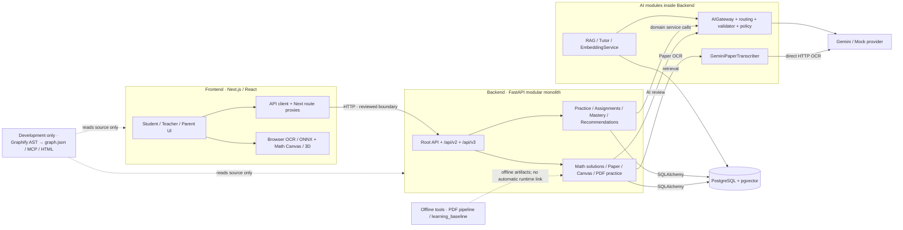

# Kiến trúc Coach Learning — Graphify

Sinh lúc 2026-11-07T11:57:12+07:00; Graphify `0.9.102`; HEAD `f0e917d76273116de9ee3baa11bea1d7376faa62`.
Snapshot gồm cả source chưa commit trong working tree. Không đại diện riêng cho HEAD hoặc production.

Đã phát hiện **1,516 file code**, tạo **14,904 nodes / 66,617 quan hệ / 422 communities**.
Có 1,495 file xuất hiện trên node. Fingerprint source: `975dea1bb3c504b6a63c4060cb7d36ec929e3ae5fb8a64e3c30cceef48b96178`.
Chỉ phân tích AST cục bộ; semantic LLM: **0 tokens**. Nhãn community lấy từ hub, không dùng model.

## Phân bố node

| Lớp | Nodes | File có node |
|---|---:|---:|
| AI | 374 | 39 |
| Backend | 5,200 | 542 |
| Frontend | 2,210 | 340 |
| Other | 1,865 | 15 |
| Tests | 3,488 | 378 |
| Tools | 1,767 | 181 |

AI trong bảng chỉ gồm `backend/app/ai`, `rag`, `tutor`; adapter AI/OCR trong domain khác vẫn thuộc Backend.
Tests được tách riêng; node không có source xác định nằm trong Other. Đây là cách nhóm đường dẫn, không phải service triển khai độc lập.

## Quan hệ AST giữa các lớp

Các cặp không có hướng; số lượng là link lưu trong graph, không phải số request hay số luồng nghiệp vụ.
| Lớp A | Lớp B | Links |
|---|---|---:|
| AI | Backend | 544 |
| AI | Other | 269 |
| AI | Tests | 628 |
| AI | Tools | 15 |
| Backend | Other | 5,825 |
| Backend | Tests | 13,189 |
| Backend | Tools | 413 |
| Frontend | Other | 154 |
| Frontend | Tests | 695 |
| Other | Tests | 4,091 |
| Other | Tools | 1,215 |
| Tests | Tools | 1,245 |

Confidence: `EXTRACTED`: 56,090, `INFERRED`: 10,527.

## Các cặp module liên kết nhiều nhất

| Module A | Module B | Links |
|---|---|---:|
| `backend/app/questions` | `root` | 1,199 |
| `root` | `tools/pdf_metadata` | 1,127 |
| `backend/app/questions` | `backend/tests/questions` | 864 |
| `backend/tests/questions` | `root` | 855 |
| `backend/app/curriculum` | `root` | 461 |
| `backend/app/math_solutions` | `backend/tests/math_solutions` | 449 |
| `frontend/src/app` | `frontend/src/lib` | 388 |
| `backend/tests/math_solutions` | `root` | 383 |
| `backend/app/ai` | `backend/tests/ai` | 319 |
| `backend/app/question_acquisition` | `backend/tests/question_acquisition` | 314 |
| `frontend/src/features/math-workspace` | `frontend/tests` | 312 |
| `backend/app/classes` | `backend/tests/classes` | 308 |
| `backend/app/question_supply` | `backend/tests/question_supply` | 299 |
| `backend/app/math_solutions` | `root` | 295 |
| `frontend/src/features/math-workspace` | `frontend/src/lib` | 264 |
| `backend/tests/curriculum` | `root` | 236 |
| `backend/migrations` | `root` | 228 |
| `root` | `tools/ocr-v2-lab` | 218 |
| `backend/app/misconceptions` | `backend/tests/misconceptions` | 204 |
| `backend/app/knowledge_gap` | `backend/tests/knowledge_gap` | 202 |

## Phạm vi và giới hạn

- Chi tiết ranh giới HTTP, AI và offline: [relationships.md](relationships.md).
- Graph tương tác: `graphify-out/graph.html`; GraphML: `graphify-out/graph.graphml`; graph đầy đủ: `graphify-out/graph.json`.
- HTML dùng community aggregation khi vượt 1.800 nodes; JSON/GraphML giữ graph đầy đủ.
- AST không tự chứng minh HTTP, dependency injection, dynamic calls hay tính đúng của nghiệp vụ. Thiếu cạnh không chứng minh hai module độc lập.
- Node module bên ngoài có thể dùng tên package trong source_file khi chưa cài node_modules; không tính các stub này như file source của repo.
- File không có symbol, code ngoài grammar, dữ liệu, CSS và tài liệu chưa chạy semantic có thể không có node; xem `graphify-out/coverage.json` và `build.log`.
- Có cảnh báo parser ở test hiện có `frontend/tests/ocr-math-preview.test.ts`; không sửa test hoặc nghiệp vụ trong tích hợp này.
- Không index secrets, dump DB, dữ liệu học sinh, model, dependency, file build hoặc bản sao worktree. Không gọi DB/API AI.
- Chạy `tools/graphify/build.ps1` để cập nhật; graph hết hiệu lực sau khi source thay đổi cho đến lần build tiếp theo.
