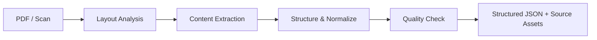

# Slide 06 — From PDF to Structured Mathematical Data

**Mô tả:** Trích xuất và chuẩn hóa nội dung Toán học, kèm nguồn đối chiếu và trạng thái chất lượng.

## Luồng trên slide



## Nội dung các khối

Giữ bố cục ba cột INPUT / PROCESSING / OUTPUT như bản gốc.

**INPUT:** PDF có lớp text / PDF scan.

**PROCESSING:** Bốn khối nối tiếp, mỗi khối có một dòng mô tả.

| Khối | Mô tả trên slide |
| --- | --- |
| **Layout Analysis** | Phân vùng & xác định thứ tự đọc |
| **Content Extraction** | Văn bản · Công thức · Bảng/hình |
| **Structure & Normalize** | Ghép nội dung & chuẩn hóa định dạng |
| **Quality Check** | Kiểm tra cấu trúc & gắn cờ lỗi |

**OUTPUT:** Structured JSON + Source Assets.

Nhãn dưới đầu ra: **Có nguồn đối chiếu · Kèm trạng thái chất lượng**.

Không cần vẽ riêng các nhánh text/math/table. Gộp chúng thành một dòng trong
Content Extraction để luồng dễ đọc.

## JSON hiển thị

Trích đoạn minh họa, không phải record đầy đủ để kiểm schema:

```json
{
  "source_number": 1,
  "question": {
    "markdown": "Tính tích phân $\\int_{0}^{1} x^{2}\\,dx$."
  },
  "academic_review": "PENDING"
}
```

## Ghi chú thuyết trình

- Content Extraction đọc trực tiếp text/glyph khi dùng được, OCR vùng ảnh khi
  cần; bảng/hình hoặc vùng chưa chắc được giữ bằng ảnh nguồn.
- Structure & Normalize ghép câu hỏi, phương án, lời giải và đáp án khi có;
  giữ PDF, trang, tọa độ và ảnh để truy vết.
- Quality Check kiểm cấu trúc dữ liệu và cảnh báo nội dung chưa chắc.
  Mọi bản ghi vẫn được xuất kèm trạng thái; lỗi hoặc vùng mơ hồ cần duyệt.
  Kiểm tra kỹ thuật không tự phê duyệt tính đúng toán học.
- AI Core là bước sử dụng dữ liệu sau pipeline này, theo trạng thái kiểm duyệt
  và phạm vi cho phép. Dự án hiện vẫn giữ trạng thái học thuật chờ duyệt.

## Căn cứ trong dự án

- [Pipeline dữ liệu và giới hạn nối core](pdf-usable-pipeline.md).
- [Trích xuất công thức, bảng và ảnh nguồn](pdf-transcription-v2.md).
- [Hợp đồng metadata đầu ra](pdf-metadata-schema-v1.md).

Phạm vi thay đổi: nội dung đề xuất cho slide.
