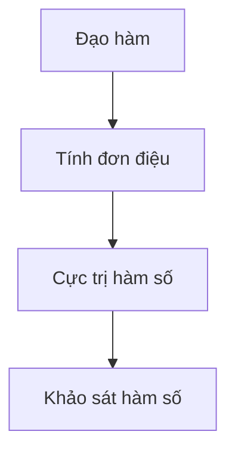

# Slide 12 — Từ lỗi sai đến kiến thức cần củng cố

## Nhận xét đối chiếu với dự án

Slide gốc đúng mục tiêu truy tìm kiến thức liên quan đến lỗi sai và hỗ trợ học
tập cá nhân hóa. Cần sửa cách thể hiện quan hệ và mức chắc chắn của chẩn đoán.

1. Quan hệ tiên quyết phải có hướng. Bộ dữ liệu canonical hiện có chuỗi
   `DERIVATIVE → MONOTONICITY → EXTREMA → FUNCTION_ANALYSIS`.
   Các cạnh trong hình gốc không biểu diễn đúng chuỗi này.
2. `Xét dấu đạo hàm` có thể là kỹ năng/nội dung câu hỏi kiểm tra, nhưng không
   phải một Concept độc lập trong file concepts canonical hiện tại. Không vẽ
   thêm nút này như thể đã có trong graph dự án.
3. Không trộn vai trò như “kiến thức nền”, “kiến thức đích” với trạng thái
   mastery như “cần củng cố”. Một đáp án sai không đủ để kết luận học sinh có
   lỗ hổng bền vững hoặc một misconception đã xác nhận.
4. Phải bổ sung bước xác minh. Root-cause diagnosis có trạng thái giả thuyết;
   verification dùng tối thiểu hai câu đã có kết quả đánh giá hợp lệ cho mỗi
   mục tiêu trước khi đưa ra kết quả có/không có bằng chứng hỗ trợ. Nếu chưa
   rõ thì thu thập thêm dữ liệu; nếu thiếu câu APPROVED thì báo chưa có câu.
5. Concept và ProblemType là hai loại khác nhau, có mapping riêng. Mastery
   của hai loại cũng được lưu riêng. Graph chung; trạng thái học sinh là lớp
   dữ liệu gắn lên graph, không phải thay đổi cấu trúc graph theo từng học sinh.

## Nội dung thay thế trên slide

**Nhãn:** 04 / CÁ NHÂN HÓA HỌC TẬP · 12 / KNOWLEDGE GRAPH

**Tiêu đề:** Từ lỗi sai đến kiến thức cần củng cố

**Mô tả:** Kết hợp đồ thị tiên quyết và bằng chứng học tập để đề xuất bước học tiếp theo.

**Cột trái — Đồ thị kiến thức**

Chú thích cạnh: **Mũi tên: kiến thức tiên quyết → kiến thức phụ thuộc**.

Nút Đạo hàm có nhãn **Giả thuyết cần kiểm tra**, tô vàng nhạt. Các nút còn
lại xanh nhạt trung tính, không gán trạng thái thành thạo khi chưa có dữ liệu.

Nhãn riêng dưới graph: **Dạng bài: Xác định khoảng đơn điệu**. Đây là
ProblemType, không đặt như một Concept trong chuỗi tiên quyết.

**Cột phải — Ví dụ chẩn đoán**

- **Lỗi quan sát:** Chọn nghịch biến khi bảng cho f′(x) > 0.
- **Giả thuyết:** Nhầm dấu đạo hàm với chiều biến thiên.
- **Xác minh:** Hai câu ngắn về dấu đạo hàm và chiều biến thiên.
- **Hỗ trợ tiếp theo:** Chọn bài củng cố theo kết quả xác minh; chưa rõ thì
  thu thập thêm bằng chứng.

Ghi rõ **Tình huống minh họa**, không phải kết quả chẩn đoán của một học sinh thật.

**Dòng cuối:** Lỗi sai → Giả thuyết từ graph & lịch sử → Xác minh → Củng cố phù hợp.

## Căn cứ đã kiểm tra

- [Concept canonical](../backend/data/curriculum/math/grade12/gdpt2018/concepts.json).
- [Quan hệ tiên quyết canonical](../backend/data/curriculum/math/grade12/gdpt2018/concept_relations.json).
- [Mapping dạng bài–concept](../backend/data/curriculum/math/grade12/gdpt2018/problem_type_concepts.json).
- [Mô hình curriculum và mastery](curriculum-model.md).
- [Trạng thái giả thuyết của root-cause diagnosis](../backend/app/knowledge_gap/models.py).
- [Xếp hạng nguyên nhân từ mastery, lỗi, graph và lịch sử](../backend/app/knowledge_gap/root_cause.py).
- [Chọn câu và đánh giá xác minh](../backend/app/knowledge_gap/verification_policy.py).
- [Chọn bước tiếp theo sau xác minh](../backend/app/knowledge_gap/target_resolver.py).
- [Misconception dấu đạo hàm và chiều biến thiên](../backend/data/seed/misconceptions.py).

Chỉ sửa nội dung đề xuất cho slide, không thay đổi graph hoặc thuật toán dự án.
