# Math Canvas Pipeline

Sơ đồ kiến trúc theo code hiện tại: khám phá công thức trên trình duyệt,
lưu bản trực quan hóa theo bài làm và cho giáo viên xem lại.

## Bản vẽ bàn giao

- [Canva chỉnh sửa](https://www.canva.com/d/1FhzbYU7HQRD4oS).
- [Canva xem](https://www.canva.com/d/RHBcyFs7X3VSPHy).
- [PowerPoint chỉnh sửa](../artifacts/math-canvas-pipeline/Math_Canvas_Pipeline.pptx).
- [PNG 1920×1080](../artifacts/math-canvas-pipeline/Math_Canvas_Pipeline.png).
- [Script tạo bản vẽ](../artifacts/math-canvas-pipeline/generate.py).

Slide chính gộp lấy mẫu, dựng hình và tương tác vào **Render & Explore**;
nhánh nhập trực tiếp nối vào parser, không đi qua nhận dạng nét viết.

```mermaid
flowchart LR
    subgraph INPUT[Đầu vào]
        A[Nét viết được khoanh vùng]
        B[Nhập công thức / bước đã xác nhận]
    end
    subgraph BROWSER[Trình duyệt · Next.js / React]
        C[CoMER local · ONNX / WASM]
        D[LaTeX nháp]
        E[Chuẩn hóa & phân tích AST có giới hạn]
        F[Phân loại biểu diễn & tham số]
        G[Lấy mẫu hình học & dựng hình 2D/3D · Three.js]
        H[Khám phá: tham số, camera, zoom]
        I[Xác nhận / sửa công thức OCR trước khi lưu hoặc hỏi AI]
        X[Báo lỗi / yêu cầu sửa nếu chưa hỗ trợ]
    end
    subgraph SERVER[Backend · FastAPI / PostgreSQL]
        J[Snapshot API: kiểm quyền, spec & nét nguồn]
        K[Snapshot: công thức, settings, camera, nguồn ink, ghi chú]
        L[Giáo viên xem lại theo quyền lớp học]
        M[AI Gateway → Gemini · giải thích tùy chọn]
    end
    A --> C --> D --> E
    B --> E
    E --> F --> G --> H
    E -->|Không hợp lệ / chưa hỗ trợ| X
    H -->|Đổi tham số| G
    H --> I
    I -->|Lưu vào bài học| J --> K --> L
    I -.->|Yêu cầu, nhánh một công thức đủ điều kiện| M
    M -.->|Giải thích công thức & tham số| H
```

## Nội dung ngắn trên slide

**Tiêu đề:** Math Canvas Pipeline

**Mô tả:** Từ nét viết đến khám phá Toán học bằng hình ảnh 2D/3D.

| INPUT | BROWSER PROCESSING | SERVICES & OUTPUT |
| --- | --- | --- |
| Nét viết được chọn | Handwriting Recognition — CoMER local → LaTeX nháp | Lesson Snapshot — API kiểm quyền & dữ liệu |
| Nhập công thức / bước đã xác nhận, bỏ qua OCR | Parse & Validate — Chuẩn hóa → AST → Loại hình & tham số | Công thức · Tham số · Camera · Nét nguồn · Ghi chú |
| | Render 2D / 3D — Lấy mẫu hình học · Three.js | Giáo viên xem lại hình & nét viết gốc |
| | Interactive Exploration — Chỉnh tham số · Xoay · Zoom | AI giải thích tùy chọn, nhánh một công thức đủ điều kiện |

**Điểm kiểm tra:** Xác nhận / sửa OCR trước khi lưu hoặc hỏi AI.

**Dòng cuối:** Viết / nhập công thức → Khám phá trực quan → Lưu & xem lại bài học.

## Giới hạn cần thể hiện đúng

- Đây là kiến trúc khám phá trực quan; không tự chấm bài hay cập nhật mastery.
- Nhận dạng nét viết dùng CoMER local trong trình duyệt, không gọi Gemini để
  nhận dạng trong luồng này. Nhập trực tiếp và bước đã xác nhận bỏ qua OCR.
- Preview có thể hiển thị trước khi xác nhận OCR; bước xác nhận chặn lưu/hỏi
  AI, không chặn mọi hoạt động xem trước. Công thức nhập trực tiếp không cần
  một lần xác nhận OCR riêng.
- AST và các loại document được hỗ trợ có giới hạn; không phải parser LaTeX
  tổng quát. Có nhánh một công thức, scene nhiều biểu thức và Math Lab.
- Tác vụ lấy mẫu nặng ở các nhánh hỗ trợ có worker; không phải mọi dựng hình
  đều chạy trong worker. Đổi tham số cập nhật hình; camera là trạng thái xem.
- Snapshot gắn với attempt, nguồn ink và phiên bản; server kiểm quyền và từ
  chối nguồn/giải thích không còn khớp. Giáo viên chỉ đọc theo quyền lớp hiện tại.
- AI giải thích là nhánh tùy chọn, cần cấu hình provider. Endpoint explain
  hiện từ chối spec Scene/Lab; không vẽ AI như bước bắt buộc cho mọi loại hình.
- Không gắn nối đề xuất mới trong tài liệu tích hợp thành chức năng đã hoàn tất.

## Căn cứ mã nguồn

- [Luồng Math View hiện tại](math-view-3d.md).
- [Thiết kế Math Canvas và snapshot](math-canvas.md).
- [Điều phối panel và xác nhận OCR](../frontend/src/features/math-canvas/MathCanvasPanel.tsx).
- [Nhận dạng nét viết CoMER trên trình duyệt](../frontend/src/features/math-workspace/utils/handwritten-ocr.ts).
- [Chuẩn hóa và AST](../frontend/src/features/math-canvas/expression.ts).
- [Khung nhìn Three.js](../frontend/src/features/math-canvas/GraphView.tsx).
- [Scene nhiều biểu thức](../frontend/src/features/math-canvas/GraphScenePanel.tsx).
- [Snapshot service và quyền giáo viên](../backend/app/math_canvas/service.py).
- [API snapshot / giải thích và giới hạn Scene/Lab](../backend/app/math_canvas/router.py).
- [Schema spec, camera và nguồn](../backend/app/math_canvas/schemas.py).
