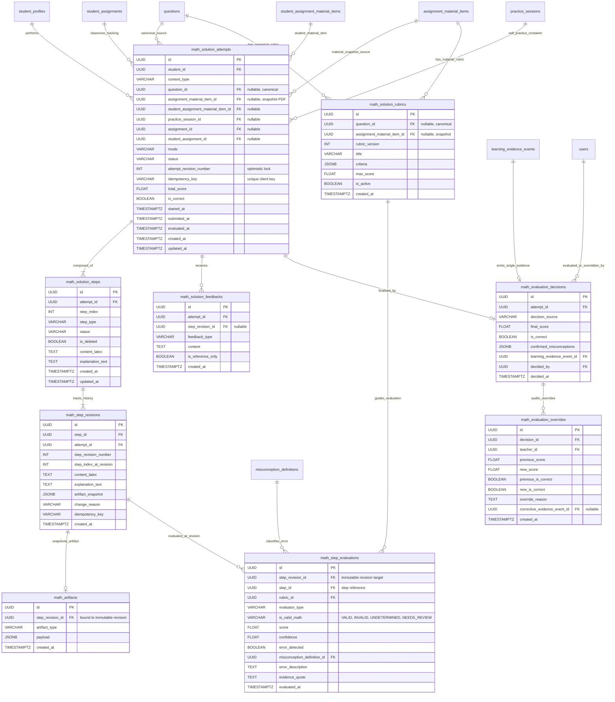

# Thiết kế Thực thể - Quan hệ (Entity-Relationship Diagram & Schema Specification)
## Module `backend/app/math_solutions/` (Hiệu chỉnh Kiến trúc Sprint 1.1)

- **Dự án**: Coach Learning (EduMS)
- **Mã tài liệu**: ERD-STEP-01
- **Mã Sprint**: SPRINT-01.1
- **Trạng thái**: ĐẶC TẢ LƯỢC ĐỒ CHUẨN XÁC (PRODUCTION-READY SPECIFICATION)

---

## 1. Biểu đồ Thực thể - Quan hệ (Mermaid ERD)



---

## 2. Đặc tả Chi tiết Các Bảng (Table Specifications)

### 2.1. `math_solution_attempts`
Quản lý phiên làm bài giải toán của học sinh. Hỗ trợ **hai nguồn bài tập bình đẳng**: Câu hỏi chuẩn tắc (`Question`) và Câu hỏi bóc tách từ tài liệu PDF giáo viên (`AssignmentMaterialItem`).

- **Khóa chính**: `id` (`UUID`, mặc định `gen_random_uuid()`).
- **Khóa ngoại**:
  - `student_id` $\to$ `student_profiles(id)` [ON DELETE RESTRICT]
  - `question_id` $\to$ `questions(id)` [ON DELETE RESTRICT, NULLABLE]
  - `assignment_material_item_id` $\to$ `assignment_material_items(id)` [ON DELETE RESTRICT, NULLABLE]
  - `student_assignment_material_item_id` $\to$ `student_assignment_material_items(id)` [ON DELETE CASCADE, NULLABLE]
  - `practice_session_id` $\to$ `practice_sessions(id)` [ON DELETE SET NULL, NULLABLE]
  - `assignment_id` $\to$ `assignments(id)` [ON DELETE CASCADE, NULLABLE]
  - `student_assignment_id` $\to$ `student_assignments(id)` [ON DELETE CASCADE, NULLABLE]
- **Thuộc tính**:
  - `context_type`: `VARCHAR(50)` ('SELF_PRACTICE' hoặc 'CLASSROOM_ASSIGNMENT').
  - `mode`: `VARCHAR(50)` ('GUIDED_LEARNING' hoặc 'INDEPENDENT_SOLUTION').
  - `status`: `VARCHAR(50)` ('DRAFT', 'IN_PROGRESS', 'SUBMITTED', 'EVALUATED', 'ABANDONED').
  - `attempt_revision_number`: `INT` (mặc định 1, tăng đơn điệu mỗi khi có thay đổi cấu trúc phiên — phục vụ Khóa lạc quan).
  - `idempotency_key`: `VARCHAR(100)` (khóa chống trùng lặp do mạng từ client).
  - `total_score`: `DOUBLE PRECISION` (0.0 đến 1.0, null khi chưa chấm).
  - `is_correct`: `BOOLEAN` (null khi chưa có kết luận).
  - `started_at`: `TIMESTAMPTZ` (mặc định `NOW()`).
  - `submitted_at`: `TIMESTAMPTZ` (null khi đang giải).
  - `evaluated_at`: `TIMESTAMPTZ` (null khi chưa đánh giá xong).
- **Ràng buộc Toàn vẹn (Constraints)**:
  - **chk_solution_source_exclusive**: Loại trừ nguồn bài tập — bắt buộc phải trỏ vào đúng 1 nguồn:
    ```sql
    CHECK (
        (question_id IS NOT NULL AND assignment_material_item_id IS NULL AND student_assignment_material_item_id IS NULL) OR
        (question_id IS NULL AND assignment_material_item_id IS NOT NULL AND student_assignment_material_item_id IS NOT NULL)
    )
    ```
  - **chk_solution_context_alignment**: Phù hợp ngữ cảnh làm bài:
    ```sql
    CHECK (
        (context_type = 'SELF_PRACTICE' AND practice_session_id IS NOT NULL AND assignment_id IS NULL AND student_assignment_id IS NULL AND question_id IS NOT NULL) OR
        (context_type = 'CLASSROOM_ASSIGNMENT' AND assignment_id IS NOT NULL AND student_assignment_id IS NOT NULL)
    )
    ```
  - **chk_solution_attempt_score**: `total_score IS NULL OR (total_score >= 0.0 AND total_score <= 1.0)`.
  - **uq_solution_attempt_idempotency**: `UNIQUE (student_id, idempotency_key) WHERE idempotency_key IS NOT NULL`.
- **Chỉ mục**:
  - `ix_math_solution_attempts_student`: `(student_id, started_at)`.
  - `ix_math_solution_attempts_question`: `(question_id, status)` (khi question_id not null).
  - `ix_math_solution_attempts_material`: `(assignment_material_item_id, status)` (khi assignment_material_item_id not null).
  - `ix_math_solution_attempts_assignment`: `(assignment_id, student_id)`.

---

### 2.2. `math_solution_steps`
Lưu trữ từng bước giải logic trong bài toán.
- **Khóa chính**: `id` (`UUID`).
- **Khóa ngoại**:
  - `attempt_id` $\to$ `math_solution_attempts(id)` [ON DELETE CASCADE]
- **Thuộc tính**:
  - `step_index`: `INT` (Vị trí hiển thị của bước, bắt đầu từ 1).
  - `step_type`: `VARCHAR(50)` ('ASSUMPTION', 'DERIVATIVE_CALCULATION', 'ROOT_FINDING', 'SIGN_TABLE', 'VARIATION_TABLE', 'CONCLUSION', 'EXPLANATION', 'CUSTOM').
  - `status`: `VARCHAR(50)` ('DRAFT', 'ACTIVE', 'DELETED').
  - `is_deleted`: `BOOLEAN` (mặc định `FALSE` - xóa mềm).
  - `content_latex`: `TEXT`.
  - `explanation_text`: `TEXT`.
- **Ràng buộc & Chỉ mục**:
  - `step_index >= 1`.
  - **uq_math_solution_step_active_index**: `UNIQUE (attempt_id, step_index) WHERE is_deleted = FALSE DEFERRABLE INITIALLY DEFERRED`.
    *(Lưu ý: Ràng buộc UNIQUE được cấu hình `DEFERRABLE INITIALLY DEFERRED` trong PostgreSQL để cho phép swap/reorder thứ tự các bước trong cùng một transaction mà không bị bắn lỗi vi phạm ràng buộc giữa chừng).*
  - `ix_math_solution_steps_attempt`: `(attempt_id, step_index)`.

---

### 2.3. `math_step_revisions`
Lịch sử phiên bản chỉnh sửa của từng bước, phục vụ chống mất dữ liệu, theo dõi tư duy và rollback.
- **Khóa chính**: `id` (`UUID`).
- **Khóa ngoại**:
  - `step_id` $\to$ `math_solution_steps(id)` [ON DELETE CASCADE]
  - `attempt_id` $\to$ `math_solution_attempts(id)` [ON DELETE CASCADE]
- **Thuộc tính**:
  - `step_revision_number`: `INT` (Số thứ tự phiên bản của bước: 1, 2, 3...).
  - `step_index_at_revision`: `INT` (Vị trí của bước tại thời điểm lưu revision đó).
  - `content_latex`: `TEXT`.
  - `explanation_text`: `TEXT`.
  - `artifact_snapshot`: `JSONB` (Ảnh chụp bảng xét dấu/bảng biến thiên tại revision đó).
  - `change_reason`: `VARCHAR(50)` ('STUDENT_EDIT', 'STUDENT_REORDER', 'AUTOSAVE', 'ROLLBACK').
  - `idempotency_key`: `VARCHAR(100)`.
  - `created_at`: `TIMESTAMPTZ` (mặc định `NOW()`).
- **Ràng buộc**:
  - `uq_math_step_revisions_step_rev`: `UNIQUE (step_id, step_revision_number)`.
  - `uq_math_step_revisions_idempotency`: `UNIQUE (step_id, idempotency_key) WHERE idempotency_key IS NOT NULL`.

---

### 2.4. `math_artifacts`
Lưu trữ đối tượng toán học trực quan (bảng xét dấu, bảng biến thiên) gắn liền bất biến với một **`StepRevision`**.
- **Khóa chính**: `id` (`UUID`).
- **Khóa ngoại**:
  - `step_revision_id` $\to$ `math_step_revisions(id)` [ON DELETE CASCADE] (Quan hệ 1 - 1 bất biến).
- **Thuộc tính**:
  - `artifact_type`: `VARCHAR(50)` ('SIGN_TABLE', 'VARIATION_TABLE', 'INTERVAL_SET', 'SYSTEM_OF_EQUATIONS').
  - `payload`: `JSONB` (Dữ liệu bảng: khoảng, nghiệm, dấu $+$, $-$, $0$, $\parallel$, mũi tên).
- **Ràng buộc**:
  - `uq_math_artifacts_revision`: `UNIQUE (step_revision_id)`.

---

### 2.5. `math_solution_rubrics`
Bảng tiêu chí chấm điểm lời giải từng bước, gắn được với **cả câu hỏi canonical lẫn câu hỏi tài liệu PDF của giáo viên**.
- **Khóa chính**: `id` (`UUID`).
- **Khóa ngoại**:
  - `question_id` $\to$ `questions(id)` [ON DELETE CASCADE, NULLABLE]
  - `assignment_material_item_id` $\to$ `assignment_material_items(id)` [ON DELETE CASCADE, NULLABLE]
- **Thuộc tính**:
  - `rubric_version`: `INT` (Phiên bản rubric, mặc định 1).
  - `title`: `VARCHAR(255)`.
  - `criteria`: `JSONB` (Danh sách tiêu chí: mã, mô tả, trọng số, nhánh giải tương đương, biểu thức kỳ vọng).
  - `max_score`: `DOUBLE PRECISION` (Mặc định 1.0).
  - `is_active`: `BOOLEAN` (Mặc định `TRUE`).
- **Ràng buộc**:
  - **chk_rubric_target_exclusive**:
    ```sql
    CHECK (
        (question_id IS NOT NULL AND assignment_material_item_id IS NULL) OR
        (question_id IS NULL AND assignment_material_item_id IS NOT NULL)
    )
    ```
  - `uq_rubric_canonical`: `UNIQUE (question_id, rubric_version) WHERE question_id IS NOT NULL`.
  - `uq_rubric_material`: `UNIQUE (assignment_material_item_id, rubric_version) WHERE assignment_material_item_id IS NOT NULL`.

---

### 2.6. `math_step_evaluations`
Kết quả đánh giá tính đúng đắn toán học và sư phạm. **Bắt buộc gắn với `step_revision_id` bất biến** để bảo toàn tính toàn vẹn khoa học.
- **Khóa chính**: `id` (`UUID`).
- **Khóa ngoại**:
  - `step_revision_id` $\to` `math_step_revisions(id)` [ON DELETE CASCADE] (Mục tiêu đánh giá thực tế).
  - `step_id` $\to` `math_solution_steps(id)` [ON DELETE CASCADE] (Tham chiếu tiện ích).
  - `rubric_id` $\to` `math_solution_rubrics(id)` [ON DELETE SET NULL, NULLABLE]
  - `misconception_definition_id` $\to` `misconception_definitions(id)` [ON DELETE SET NULL, NULLABLE]
- **Thuộc tính**:
  - `evaluator_type`: `VARCHAR(50)` ('DETERMINISTIC_RULES', 'AI_HEURISTIC', 'TEACHER').
  - `is_valid_math`: `VARCHAR(20)` NOT NULL CHECK (`is_valid_math` IN ('VALID', 'INVALID', 'UNDETERMINED', 'NEEDS_REVIEW')).
    *(Xử lý đầy đủ trường hợp CAS timeout, cú pháp không tường minh hoặc biểu thức vượt khả năng phân tích tự động).*
  - `score`: `DOUBLE PRECISION` (0.0 đến 1.0).
  - `confidence`: `DOUBLE PRECISION` (0.0 đến 1.0).
  - `error_detected`: `BOOLEAN` (True nếu bước có lỗi).
  - `error_description`: `TEXT`.
  - `evidence_quote`: `TEXT`.
  - `evaluated_at`: `TIMESTAMPTZ` (mặc định `NOW()`).
- **Chỉ mục**:
  - `ix_math_step_evaluations_revision`: `(step_revision_id, evaluator_type)`.

---

### 2.7. `math_solution_feedbacks`
Các phản hồi hướng dẫn sư phạm gửi đến học sinh.
- **Khóa chính**: `id` (`UUID`).
- **Khóa ngoại**:
  - `attempt_id` $\to$ `math_solution_attempts(id)` [ON DELETE CASCADE]
  - `step_revision_id` $\to$ `math_step_revisions(id)` [ON DELETE SET NULL, NULLABLE]
- **Thuộc tính**:
  - `feedback_type`: `VARCHAR(50)` ('REFERENCE_HINT', 'SOCRATIC_QUESTION', 'VERIFICATION_ALERT', 'ERROR_CORRECTION').
  - `content`: `TEXT`.
  - `is_reference_only`: `BOOLEAN` (Mặc định `TRUE`).
  - `created_at`: `TIMESTAMPTZ`.

---

### 2.8. `math_evaluation_decisions`
Quyết định đánh giá chung cuộc của toàn bài.
- **Khóa chính**: `id` (`UUID`).
- **Khóa ngoại**:
  - `attempt_id` $\to$ `math_solution_attempts(id)` [ON DELETE CASCADE] (Quan hệ 1 - 1).
  - `learning_evidence_event_id` $\to$ `learning_evidence_events(id)` [ON DELETE SET NULL, NULLABLE]
  - `decided_by` $\to$ `users(id)` [ON DELETE SET NULL, NULLABLE]
- **Thuộc tính**:
  - `decision_source`: `VARCHAR(50)` ('AUTOMATED_CONSENSUS', 'TEACHER_OVERRIDE', 'AUDIT_APPROVED').
  - `final_score`: `DOUBLE PRECISION` (0.0 đến 1.0).
  - `is_correct`: `BOOLEAN`.
  - `confirmed_misconceptions`: `JSONB` (Mảng mã lỗi được xác nhận).
  - `decided_at`: `TIMESTAMPTZ`.
- **Ràng buộc**:
  - `uq_math_evaluation_decision_attempt`: `UNIQUE (attempt_id)`.

---

### 2.9. `math_evaluation_overrides` (Audit History của Giáo viên)
Lưu vết toàn bộ lịch sử can thiệp điểm số và nhận xét của giáo viên, bảo vệ tính bất biến của bảng `learning_evidence_events`.
- **Khóa chính**: `id` (`UUID`).
- **Khóa ngoại**:
  - `decision_id` $\to$ `math_evaluation_decisions(id)` [ON DELETE CASCADE]
  - `teacher_id` $\to$ `users(id)` [ON DELETE RESTRICT]
  - `corrective_evidence_event_id` $\to$ `learning_evidence_events(id)` [ON DELETE SET NULL, NULLABLE]
- **Thuộc tính**:
  - `previous_score`: `DOUBLE PRECISION`.
  - `new_score`: `DOUBLE PRECISION`.
  - `previous_is_correct`: `BOOLEAN`.
  - `new_is_correct`: `BOOLEAN`.
  - `override_reason`: `TEXT` NOT NULL.
  - `created_at`: `TIMESTAMPTZ` (mặc định `NOW()`).

---

## 3. Kiến trúc Đồng bộ & Giải quyết Xung đột (Concurrency & Integrity)

### 3.1. Cơ chế Reorder không gây Xung đột Unique Constraint
Khi học sinh đổi thứ tự bước (ví dụ: đổi bước 1 thành 2, bước 2 thành 1):
1. **Phương pháp Postgres Deferrable**: Định nghĩa ràng buộc `uq_math_solution_step_active_index` là `DEFERRABLE INITIALLY DEFERRED`. Việc kiểm tra duy nhất chỉ thực hiện khi transaction kết thúc (COMMIT), cho phép hoán đổi vị trí mà không phát sinh lỗi trùng index.
2. **Kỹ thuật Two-Phase Reindexing (Phòng ngừa cấp ứng dụng)**:
   - Pha 1: `UPDATE math_solution_steps SET step_index = -new_index WHERE ...`
   - Pha 2: `UPDATE math_solution_steps SET step_index = ABS(step_index) WHERE ...`

### 3.2. Khóa Lạc quan (Optimistic Concurrency Control)
- `SolutionAttempt.attempt_revision_number` quản lý phiên bản toàn phiên.
- Mọi thao tác autosave hoặc sửa bước gửi kèm `expected_attempt_revision`.
- Nếu phát hiện `expected_attempt_revision != attempt.attempt_revision_number`, hệ thống từ chối ghi đè và trả về lỗi `HTTP 409 CONFLICT_ATTEMPT_REVISION_MISMATCH` kèm payload mới nhất để client merge.

### 3.3. Khóa Bất biến Sau Nộp bài (Post-Submission Immutability)
Khi trạng thái bài làm chuyển sang `SUBMITTED` hoặc `EVALUATED`:
- Tầng service kích hoạt **Write Lock**: từ chối mọi yêu cầu `add_step`, `update_step`, `delete_step`, `reorder` từ học sinh.
- Chỉ giáo viên sở hữu lớp học mới có quyền thực hiện can thiệp điểm số thông qua bảng audit `math_evaluation_overrides`.

### 3.4. Che giấu Tiêu chí Chấm (Rubric Concealment)
- API phục vụ học sinh (`GET /attempts/{id}`) tuyệt đối không serialize trường `criteria` và biểu thức kỳ vọng của `SolutionRubric` trước khi nộp bài.
- Học sinh chỉ nhận được danh sách tiêu chí sau khi bài làm đã ở trạng thái `EVALUATED` hoặc trong chế độ `GUIDED_LEARNING` khi hệ thống mở từng gợi ý cụ thể.

---

## 4. Architecture Decision Record (ADR)

### ADR-02: Hoàn thiện Lược đồ Quan hệ và Nguồn Dữ liệu Solution Engine

- **Trạng thái**: ĐÃ DUYỆT (ACCEPTED)
- **Quyết định**:
  1. Hỗ trợ đồng thời Canonical Question (`questions`) và Teacher Material Snapshot (`assignment_material_items`). Không ép buộc tài liệu PDF phải xuất bản vào ngân hàng công khai.
  2. Gắn kết `StepEvaluation` vào `step_revision_id` bất biến thay vì `step_id` khả biến.
  3. Mở rộng `is_valid_math` thành 4 trạng thái (`VALID`, `INVALID`, `UNDETERMINED`, `NEEDS_REVIEW`).
  4. Sử dụng Postgres Deferrable Constraint cho chỉ mục sắp xếp bước.
  5. Bổ sung bảng `math_evaluation_overrides` ghi vết giáo viên chấm bài, bảo toàn nguyên tắc append-only của `LearningEvidenceEvent`.
