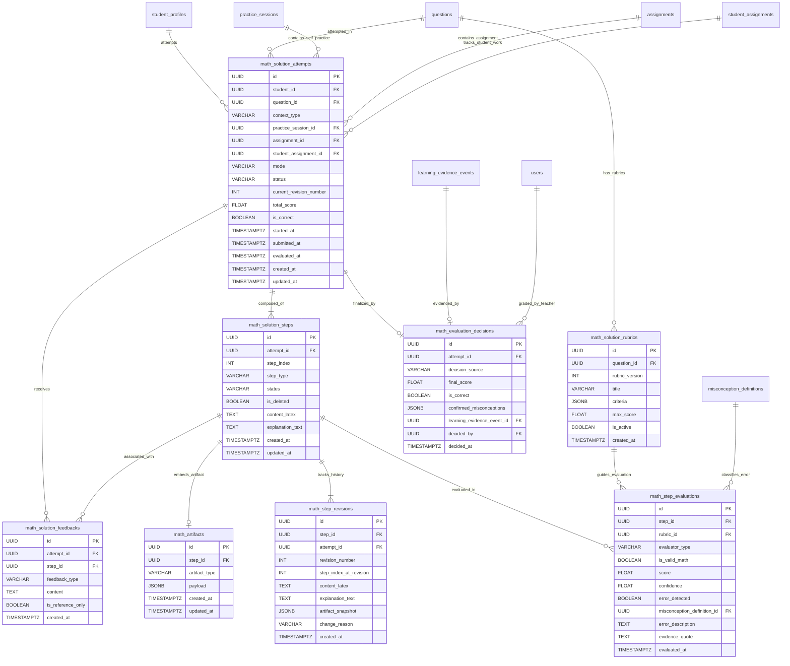
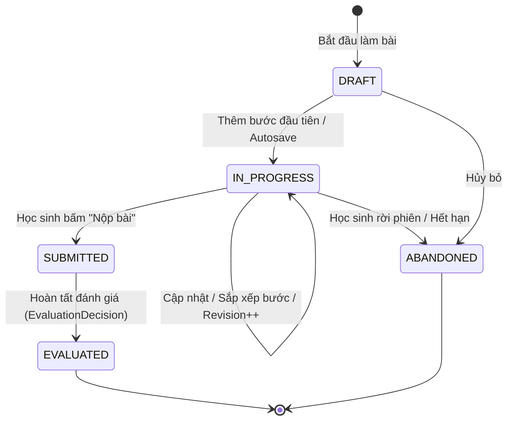
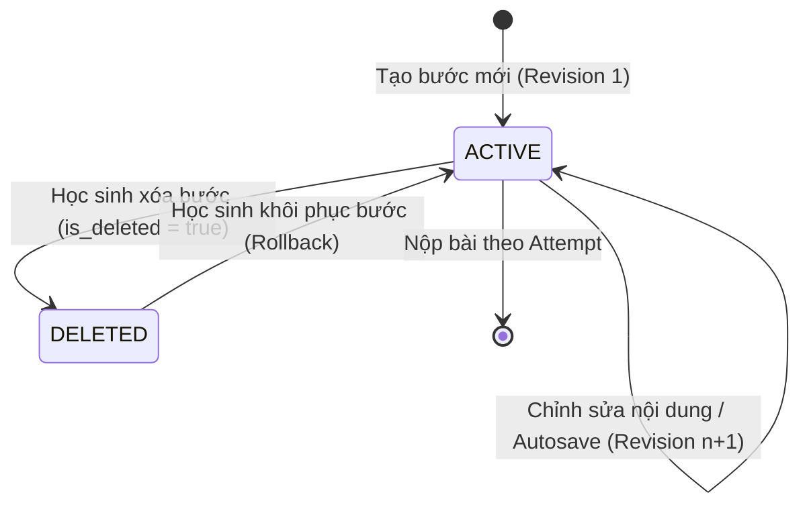

# Thiết kế Thực thể - Quan hệ (Entity-Relationship Diagram & Schema Specification)
## Module `backend/app/math_solutions/`

- **Dự án**: Coach Learning (EduMS)
- **Mã tài liệu**: ERD-STEP-01
- **Trạng thái**: ĐỀ XUẤT LƯỢC ĐỒ (SCHEMA SPECIFICATION)

---

## 1. Biểu đồ Thực thể - Quan hệ (Mermaid ERD)

---

## 2. Đặc tả Chi tiết Các Bảng (Table Specifications)

### 2.1. `math_solution_attempts`
Lưu trữ phiên giải toán tổng thể của học sinh cho một câu hỏi.
- **Khóa chính**: `id` (UUID, mặc định `gen_random_uuid()`).
- **Khóa ngoại**:
  - `student_id` $\to$ `student_profiles(id)` [ON DELETE RESTRICT]
  - `question_id` $\to$ `questions(id)` [ON DELETE RESTRICT]
  - `practice_session_id` $\to$ `practice_sessions(id)` [ON DELETE SET NULL]
  - `assignment_id` $\to$ `assignments(id)` [ON DELETE SET NULL]
  - `student_assignment_id` $\to$ `student_assignments(id)` [ON DELETE SET NULL]
- **Thuộc tính**:
  - `context_type`: `VARCHAR(50)` ('SELF_PRACTICE' hoặc 'CLASSROOM_ASSIGNMENT').
  - `mode`: `VARCHAR(50)` ('GUIDED_LEARNING' hoặc 'INDEPENDENT_SOLUTION').
  - `status`: `VARCHAR(50)` ('DRAFT', 'IN_PROGRESS', 'SUBMITTED', 'EVALUATED', 'ABANDONED').
  - `current_revision_number`: `INT` (mặc định 1, tăng mỗi khi có sửa đổi - dùng cho Khóa lạc quan).
  - `total_score`: `DOUBLE PRECISION` (0.0 đến 1.0, null khi chưa chấm).
  - `is_correct`: `BOOLEAN` (null khi chưa có kết luận).
  - `started_at`: `TIMESTAMPTZ` (mặc định `NOW()`).
  - `submitted_at`: `TIMESTAMPTZ` (null khi đang làm).
  - `evaluated_at`: `TIMESTAMPTZ` (null khi chưa đánh giá xong).
- **Ràng buộc**:
  - `chk_solution_attempt_context`: Đảm bảo nếu `SELF_PRACTICE` thì `practice_session_id` không null; nếu `CLASSROOM_ASSIGNMENT` thì `assignment_id` không null.
  - `chk_solution_attempt_score`: `total_score IS NULL OR (total_score >= 0.0 AND total_score <= 1.0)`.
- **Chỉ mục (Indexes)**:
  - `ix_math_solution_attempts_student`: `(student_id, started_at)`.
  - `ix_math_solution_attempts_question`: `(question_id, status)`.
  - `ix_math_solution_attempts_assignment`: `(assignment_id, student_id)` (partial index when assignment_id is not null).

---

### 2.2. `math_solution_steps`
Lưu trữ từng bước giải logic của bài toán.
- **Khóa chính**: `id` (UUID).
- **Khóa ngoại**:
  - `attempt_id` $\to$ `math_solution_attempts(id)` [ON DELETE CASCADE]
- **Thuộc tính**:
  - `step_index`: `INT` (Vị trí hiển thị của bước, bắt đầu từ 1).
  - `step_type`: `VARCHAR(50)` ('ASSUMPTION', 'DERIVATIVE_CALCULATION', 'ROOT_FINDING', 'SIGN_TABLE', 'VARIATION_TABLE', 'CONCLUSION', 'EXPLANATION', 'CUSTOM').
  - `status`: `VARCHAR(50)` ('DRAFT', 'ACTIVE', 'DELETED').
  - `is_deleted`: `BOOLEAN` (mặc định `FALSE` - xóa mềm).
  - `content_latex`: `TEXT` (Công thức toán LaTeX).
  - `explanation_text`: `TEXT` (Giải thích tự nhiên đi kèm).
- **Ràng buộc**:
  - `step_index >= 1`.
  - `uq_math_solution_step_attempt_index`: `UNIQUE (attempt_id, step_index, is_deleted) WHERE is_deleted = FALSE`.
- **Chỉ mục**:
  - `ix_math_solution_steps_attempt`: `(attempt_id, step_index)`.

---

### 2.3. `math_step_revisions`
Lịch sử phiên bản chỉnh sửa của từng bước, phục vụ chống mất dữ liệu, theo dõi tư duy và rollback.
- **Khóa chính**: `id` (UUID).
- **Khóa ngoại**:
  - `step_id` $\to$ `math_solution_steps(id)` [ON DELETE CASCADE]
  - `attempt_id` $\to$ `math_solution_attempts(id)` [ON DELETE CASCADE]
- **Thuộc tính**:
  - `revision_number`: `INT` (Số thứ tự phiên bản của bước, 1, 2, 3...).
  - `step_index_at_revision`: `INT` (Vị trí của bước tại thời điểm lưu revision đó).
  - `content_latex`: `TEXT`.
  - `explanation_text`: `TEXT`.
  - `artifact_snapshot`: `JSONB` (Ảnh chụp dữ liệu bảng xét dấu/bảng biến thiên tại phiên bản đó).
  - `change_reason`: `VARCHAR(50)` ('STUDENT_EDIT', 'STUDENT_REORDER', 'AUTOSAVE', 'ROLLBACK').
  - `created_at`: `TIMESTAMPTZ` (mặc định `NOW()`).
- **Ràng buộc**:
  - `uq_math_step_revisions_step_rev`: `UNIQUE (step_id, revision_number)`.
- **Chỉ mục**:
  - `ix_math_step_revisions_step_created`: `(step_id, created_at)`.

---

### 2.4. `math_artifacts`
Lưu trữ các đối tượng toán học trực quan có cấu trúc gắn liền với một bước giải.
- **Khóa chính**: `id` (UUID).
- **Khóa ngoại**:
  - `step_id` $\to$ `math_solution_steps(id)` [ON DELETE CASCADE] (Quan hệ 1 - 1).
- **Thuộc tính**:
  - `artifact_type`: `VARCHAR(50)` ('SIGN_TABLE', 'VARIATION_TABLE', 'INTERVAL_SET', 'SYSTEM_OF_EQUATIONS').
  - `payload`: `JSONB` (Cấu trúc bảng: dòng, cột, giá trị nghiệm, dấu $+$, $-$, $0$, $\parallel$, mũi tên biến thiên).
- **Ràng buộc**:
  - `uq_math_artifacts_step`: `UNIQUE (step_id)`.

---

### 2.5. `math_solution_rubrics`
Bảng tiêu chí chấm điểm lời giải từng bước của câu hỏi, hỗ trợ nhiều phương pháp giải hợp lệ.
- **Khóa chính**: `id` (UUID).
- **Khóa ngoại**:
  - `question_id` $\to$ `questions(id)` [ON DELETE CASCADE]
- **Thuộc tính**:
  - `rubric_version`: `INT` (Phiên bản rubric, mặc định 1).
  - `title`: `VARCHAR(255)`.
  - `criteria`: `JSONB` (Danh sách tiêu chí: mã, mô tả, trọng số, nhánh giải tương đương, biểu thức toán học kỳ vọng).
  - `max_score`: `DOUBLE PRECISION` (Mặc định 1.0).
  - `is_active`: `BOOLEAN` (Mặc định `TRUE`).
- **Ràng buộc**:
  - `uq_math_solution_rubrics_question_ver`: `UNIQUE (question_id, rubric_version)`.

---

### 2.6. `math_step_evaluations`
Kết quả đánh giá tính đúng đắn toán học và sư phạm cho một bước cụ thể.
- **Khóa chính**: `id` (UUID).
- **Khóa ngoại**:
  - `step_id` $\to$ `math_solution_steps(id)` [ON DELETE CASCADE]
  - `rubric_id` $\to$ `math_solution_rubrics(id)` [ON DELETE SET NULL]
  - `misconception_definition_id` $\to$ `misconception_definitions(id)` [ON DELETE SET NULL]
- **Thuộc tính**:
  - `evaluator_type`: `VARCHAR(50)` ('DETERMINISTIC_RULES', 'AI_HEURISTIC', 'TEACHER').
  - `is_valid_math`: `BOOLEAN` (Kiểm chứng toán học khách quan).
  - `score`: `DOUBLE PRECISION` (0.0 đến 1.0).
  - `confidence`: `DOUBLE PRECISION` (0.0 đến 1.0).
  - `error_detected`: `BOOLEAN` (True nếu bước có lỗi).
  - `error_description`: `TEXT` (Mô tả bản chất lỗi sư phạm).
  - `evidence_quote`: `TEXT` (Trích đoạn bằng chứng từ bài làm học sinh).
  - `evaluated_at`: `TIMESTAMPTZ` (mặc định `NOW()`).

---

### 2.7. `math_solution_feedbacks`
Các phản hồi hướng dẫn sư phạm gửi đến học sinh (gợi ý, câu hỏi Socratic, hướng dẫn sửa lỗi).
- **Khóa chính**: `id` (UUID).
- **Khóa ngoại**:
  - `attempt_id` $\to$ `math_solution_attempts(id)` [ON DELETE CASCADE]
  - `step_id` $\to$ `math_solution_steps(id)` [ON DELETE SET NULL]
- **Thuộc tính**:
  - `feedback_type`: `VARCHAR(50)` ('REFERENCE_HINT', 'SOCRATIC_QUESTION', 'VERIFICATION_ALERT', 'ERROR_CORRECTION').
  - `content`: `TEXT`.
  - `is_reference_only`: `BOOLEAN` (Mặc định `TRUE` - đảm bảo feedback không làm thay đổi điểm của học sinh).
  - `created_at`: `TIMESTAMPTZ`.

---

### 2.8. `math_evaluation_decisions`
Quyết định đánh giá chung cuộc của toàn bộ bài toán.
- **Khóa chính**: `id` (UUID).
- **Khóa ngoại**:
  - `attempt_id` $\to$ `math_solution_attempts(id)` [ON DELETE CASCADE] (Quan hệ 1 - 1 duy nhất).
  - `learning_evidence_event_id` $\to$ `learning_evidence_events(id)` [ON DELETE SET NULL]
  - `decided_by` $\to$ `users(id)` [ON DELETE SET NULL] (null nếu tự động từ hệ thống).
- **Thuộc tính**:
  - `decision_source`: `VARCHAR(50)` ('AUTOMATED_CONSENSUS', 'TEACHER_OVERRIDE', 'AUDIT_APPROVED').
  - `final_score`: `DOUBLE PRECISION` (0.0 đến 1.0).
  - `is_correct`: `BOOLEAN`.
  - `confirmed_misconceptions`: `JSONB` (Mảng mã quan niệm sai lầm được xác nhận, kèm bằng chứng).
  - `decided_at`: `TIMESTAMPTZ`.
- **Ràng buộc**:
  - `uq_math_evaluation_decision_attempt`: `UNIQUE (attempt_id)`.

---

## 3. Vòng đời Trạng thái (State Transitions)

### 3.1. Vòng đời `SolutionAttempt`

### 3.2. Vòng đời `SolutionStep`

