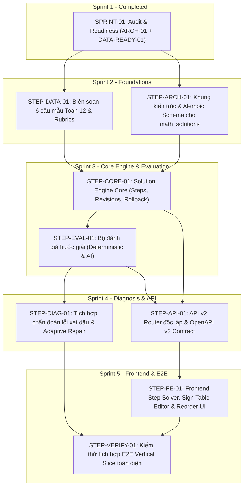

# Kế hoạch Triển khai Chi tiết (Implementation Backlog)
## Step-by-Step Math Solution Engine Roadmap

- **Dự án**: Coach Learning (EduMS)
- **Mã Sprint**: SPRINT-01 (ARCH-01 + DATA-READY-01)
- **Mã tài liệu**: BACKLOG-STEP-01
- **Trạng thái**: KẾ HOẠCH BÀN GIAO & THỨ TỰ THỰC THI (READY FOR EXECUTION)

---

## 1. Bản đồ Phụ thuộc Nhiệm vụ (Task Dependency Graph)

---

## 2. Chi tiết Danh mục Nhiệm vụ (Task Specifications)

### 2.1. Nhóm Nền tảng & Dữ liệu (Sprint 2)

#### `STEP-DATA-01` — Biên soạn & Phê duyệt Bộ 6 Câu hỏi Mẫu Toán 12 (Monotonicity)
- **Ưu tiên**: **P0 (Critical)**
- **Tiền đề (Dependencies)**: Không có.
- **Mô tả**:
  Do toàn bộ 39 nhóm câu hỏi trong staging hiện đang bị chặn bởi cổng bản quyền (`RIGHTS_REVIEW_REQUIRED`), nhiệm vụ này xây dựng bộ dữ liệu hạt nhân nguyên bản 100% thuộc sở hữu của EduMS cho dạng bài `MONOTONICITY_FROM_EXPRESSION` (Toán 12).
  Bao gồm:
  - 6 bài toán giải tích về Tính đơn điệu (hàm đa thức bậc 3, hàm trùng phương, hàm phân thức bậc 1/bậc 1).
  - Lời giải chuẩn từng bước (`CanonicalSolutionSteps`).
  - Biểu diễn bảng xét dấu có cấu trúc JSON (`SIGN_TABLE` artifact).
  - Bảng tiêu chí chấm phân trọng số (`SolutionRubric`).
  - 2 câu hỏi kiểm chứng độc lập cô lập kỹ năng xét dấu tam thức bậc hai.
  - 2 câu hỏi luyện sửa sai có giàn giáo.
- **Tệp bị ảnh hưởng / Tạo mới**:
  - `backend/data/curriculum/math/grade12/gdpt2018/math_solutions_seed.json`
  - `backend/app/math_solutions/fixtures.py`
  - `backend/tests/fixtures/math_solution_cases.py`
- **Tiêu chí nghiệm thu (Acceptance Criteria)**:
  1. 100% câu hỏi có bản quyền tự do thuộc EduMS, không trích sao trái phép từ tài liệu bên ngoài.
  2. Mỗi câu hỏi có ít nhất 1 rubric hoàn chỉnh và 1 lời giải mẫu dạng bước.
  3. Cấu trúc bảng xét dấu pass 100% schema validation.
  4. Bộ dữ liệu được hội đồng học thuật phê duyệt `APPROVED` và `PRODUCTION_ELIGIBLE`.

---

#### `STEP-ARCH-01` — Khung Kiến trúc & Migration Schema cho `math_solutions`
- **Ưu tiên**: **P0 (Critical)**
- **Tiền đề**: Phê duyệt tài liệu ERD và thiết kế kiến trúc Sprint 1.
- **Mô tả**:
  Tạo cấu trúc module `backend/app/math_solutions/`, xây dựng các model SQLAlchemy 2.0 theo đúng tài liệu `ERD.md`:
  - `SolutionAttempt`, `SolutionStep`, `StepRevision`, `MathArtifact`, `SolutionRubric`, `StepEvaluation`, `SolutionFeedback`, `EvaluationDecision`.
  - Viết Alembic migration chính thức.
- **Tệp bị ảnh hưởng / Tạo mới**:
  - `backend/app/math_solutions/__init__.py`
  - `backend/app/math_solutions/models.py`
  - `backend/app/math_solutions/schemas.py`
  - `backend/migrations/versions/xxxx_create_math_solutions_tables.py`
- **Tiêu chí nghiệm thu**:
  1. Migration chạy thành công xuôi (`alembic upgrade head`) và ngược (`alembic downgrade -1`) trên PostgreSQL.
  2. Toàn bộ các ràng buộc `CHECK`, `UNIQUE`, khóa ngoại và index được tạo chính xác.
  3. Hoàn toàn không sửa đổi hoặc ảnh hưởng tới các bảng hiện hữu (`practice_sessions`, `questions`, `assignments`, `mastery`).

---

### 2.2. Nhóm Động cơ Cốt lõi & Đánh giá (Sprint 3)

#### `STEP-CORE-01` — Động cơ Lời giải Từng bước (Step Storage, Revisions & Autosave)
- **Ưu tiên**: **P0 (Critical)**
- **Tiền đề**: `STEP-ARCH-01`, `STEP-DATA-01`.
- **Mô tả**:
  Xây dựng service xử lý các thao tác bước giải:
  - Khởi tạo phiên làm bài `SolutionAttempt` (hỗ trợ cả `SELF_PRACTICE` và `CLASSROOM_ASSIGNMENT`).
  - Thêm bước (`add_step`), sửa bước (`update_step`), xóa mềm bước (`delete_step`), sắp xếp lại bước (`reorder_steps`).
  - Lưu trữ lịch sử `StepRevision` kèm snapshot bảng xét dấu.
  - Hỗ trợ rollback bước về một revision cụ thể.
  - Cơ chế khóa lạc quan (Optimistic Locking) chống mất dữ liệu khi autosave hoặc chỉnh sửa đồng thời.
- **Tệp bị ảnh hưởng / Tạo mới**:
  - `backend/app/math_solutions/service.py`
  - `backend/app/math_solutions/step_manager.py`
  - `backend/tests/math_solutions/test_step_service.py`
- **Tiêu chí nghiệm thu**:
  1. Học sinh có thể thêm, sửa, xóa, kéo thả thay đổi thứ tự bước một cách nhất quán.
  2. Mọi chỉnh sửa đều tạo revision log bất biến; khôi phục revision thành công 100%.
  3. Phát hiện xung đột ghi đè và chặn đứng mất mát dữ liệu khi có 2 phiên autosave gửi đồng thời.
  4. Ràng buộc an toàn: Chưa có bằng chứng Mastery nào bị phát sinh trong quá trình chỉnh sửa nháp.

---

#### `STEP-EVAL-01` — Bộ Đánh giá Bước giải (Deterministic & AI Evaluator)
- **Ưu tiên**: **P1 (High)**
- **Tiền đề**: `STEP-CORE-01`.
- **Mô tả**:
  Xây dựng hệ thống đánh giá bước giải 4 tầng:
  - Tầng 1: Đánh giá toán học tất định (Deterministic Math Validator): kiểm tra cú pháp LaTeX, tính đạo hàm hình thức để đối chiếu với bước của học sinh.
  - Tầng 2: Đối chiếu Rubric tự động: kiểm tra nghiệm $y'=0$ và kiểm tra từng ô trong bảng xét dấu (`SIGN_TABLE` artifact).
  - Tầng 3: Tích hợp `AIGateway` cho các giải thích tự luận bằng lời (với Pydantic validation và prompt chuyên biệt).
  - Tầng 4: Tạo `EvaluationDecision` khi học sinh nộp bài, ghi nhận điểm và danh sách lỗi.
- **Tệp bị ảnh hưởng / Tạo mới**:
  - `backend/app/math_solutions/validator.py`
  - `backend/app/math_solutions/rubric_evaluator.py`
  - `backend/app/ai/prompts/math_step_evaluator/`
  - `backend/tests/math_solutions/test_evaluator.py`
- **Tiêu chí nghiệm thu**:
  1. Nhận diện chính xác 100% bước tính đạo hàm đúng của bài toán mẫu $y = \frac{1}{3}x^3 - x^2 - 3x + 1$.
  2. Nhận diện chính xác lỗi bảng xét dấu bị đảo ngược, gắn đúng mã `DERIVATIVE_SIGN_DIRECTION`.
  3. Xử lý được các phương án giải tương đương (nhánh thử điểm, nhánh biến đổi đại số).

---

### 2.3. Nhóm Tích hợp Chẩn đoán & API v2 (Sprint 4)

#### `STEP-DIAG-01` — Tích hợp Chẩn đoán Lỗi Xét Dấu & Adaptive Repair
- **Ưu tiên**: **P1 (High)**
- **Tiền đề**: `STEP-EVAL-01`.
- **Mô tả**:
  Kết nối kết quả đánh giá bước giải với hệ thống chẩn đoán và sửa sai:
  - Khi phát hiện lỗi xét dấu ở bước 4, cập nhật `StudentMisconception` với trạng thái `SUSPECTED` (không kết luận vội).
  - Tự động gợi ý câu hỏi kiểm chứng độc lập (`RootCauseVerification`).
  - Kích hoạt phiên can thiệp `AdaptiveRepairSession` (chế độ `GUIDED` $\to$ `FINAL_RECHECK`).
  - Sau khi học sinh hoàn thành kiểm tra lại, kích hoạt `ReviewSchedule` (Spaced Repetition SM-2).
  - Ban hành `EvaluationDecision` và phát sinh đúng 1 sự kiện `LearningEvidenceEvent` để cập nhật Mastery.
- **Tệp bị ảnh hưởng / Tạo mới**:
  - `backend/app/math_solutions/diagnosis_bridge.py`
  - `backend/app/math_solutions/evidence_adapter.py`
  - `backend/tests/math_solutions/test_diagnosis_integration.py`
- **Tiêu chí nghiệm thu**:
  1. Chỉ phát sinh duy nhất 1 `LearningEvidenceEvent` cho một phiên làm bài hoàn chỉnh.
  2. Trạng thái quan niệm sai lầm chuyển biến đúng quy trình: `SUSPECTED` $\to$ Kiểm chứng $\to$ `RESOLVED`.
  3. Spaced repetition được lập lịch chính xác (+3 ngày sau lần sửa thành công).

---

#### `STEP-API-01` — Xây dựng API v2 Router Độc lập & OpenAPI v2 Contract
- **Ưu tiên**: **P0 (Critical)**
- **Tiền đề**: `STEP-CORE-01`, `STEP-EVAL-01`.
- **Mô tả**:
  Triển khai API v2 cho Solution Engine theo phương án kiến trúc đã duyệt:
  - Tạo `backend/app/api/v2/router.py` với prefix `/api/v2`.
  - Mount các endpoints của `math_solutions` dưới `/api/v2/math-solutions/...`.
  - Mở rộng `export_contract.py` và `check_contract.py` để hỗ trợ xuất và kiểm tra độc lập cả `openapi-v1.json` và `openapi-v2.json`.
  - Thêm CI verification test đảm bảo `openapi-v1.sha256` không bị suy chuyển.
- **Tệp bị ảnh hưởng / Tạo mới**:
  - `backend/app/api/v2/__init__.py`
  - `backend/app/api/v2/router.py`
  - `backend/app/math_solutions/router.py`
  - `backend/app/api/export_contract.py`
  - `backend/app/api/check_contract.py`
  - `backend/contracts/openapi-v2.json`
  - `backend/contracts/openapi-v2.sha256`
  - `backend/tests/api_contract/test_openapi_v2.py`
- **Tiêu chí nghiệm thu**:
  1. Lệnh `python -m app.api.check_contract` báo PASS cho cả v1 và v2.
  2. `contracts/openapi-v1.json` và mã băm SHA-256 hoàn toàn nguyên vẹn 100%.
  3. Toàn bộ 11 endpoints của Solution Engine hoạt động chuẩn xác với RBAC (`STUDENT`, `TEACHER`).

---

### 2.4. Nhóm Giao diện & Kiểm chứng E2E (Sprint 5)

#### `STEP-FE-01` — Frontend Step Solver, Sign Table Editor & Reorder UI
- **Ưu tiên**: **P1 (High)**
- **Tiền đề**: `STEP-API-01`.
- **Mô tả**:
  Xây dựng giao diện giải toán từng bước trên Next.js 16:
  - Feature mới: `frontend/src/features/math-solver/`.
  - Trang làm bài: `/student/practice/solutions/[attemptId]`.
  - Component soạn thảo công thức toán (hỗ trợ nhập LaTeX và render KaTeX mượt mà).
  - Component Bảng xét dấu trực quan (`SignTableEditor`): hiển thị dòng $x$ và dòng $y'$, cho phép chọn nghiệm và điền dấu $+$, $-$, $0$, $\parallel$.
  - Danh sách bước giải hỗ trợ kéo thả sắp xếp lại vị trí bước (Drag & Drop Reordering).
  - Nút xem lịch sử phiên bản bước (Revision Viewer) và nút Khôi phục (Rollback).
- **Tệp bị ảnh hưởng / Tạo mới**:
  - `frontend/src/features/math-solver/MathSolutionSolver.tsx`
  - `frontend/src/features/math-solver/components/SignTableEditor.tsx`
  - `frontend/src/features/math-solver/components/StepCard.tsx`
  - `frontend/src/features/math-solver/components/RevisionHistoryDrawer.tsx`
  - `frontend/src/app/student/practice/solutions/[attemptId]/page.tsx`
  - `frontend/src/lib/api/v2-client.ts`
- **Tiêu chí nghiệm thu**:
  1. Giao diện mượt mà, chuẩn phong cách EduMS Verdant.
  2. Bảng xét dấu nhập liệu trực quan, không bị lỗi layout trên mobile 360px và 390px.
  3. Kéo thả đổi thứ tự bước cập nhật API tức thì và lưu revision log.

---

#### `STEP-VERIFY-01` — Kiểm thử Tích hợp E2E Vertical Slice Toàn diện
- **Ưu tiên**: **P0 (Critical)**
- **Tiền đề**: Hoàn thành toàn bộ các task trên.
- **Mô tả**:
  Thực hiện kịch bản kiểm thử tích hợp tự động không mock runtime:
  - Học sinh đăng nhập $\to$ Bắt đầu giải bài toán Tính đơn điệu.
  - Nhập bước 1 (TXĐ), bước 2 (Đạo hàm đúng).
  - Nhập bước 3 (Nghiệm), bước 4 (Bảng xét dấu sai quy tắc tam thức).
  - Hệ thống nhận diện bước 2 ĐÚNG, bước 4 SAI (gắn cờ `DERIVATIVE_SIGN_DIRECTION`).
  - Tạo giả thuyết `SUSPECTED` $\to$ Làm câu kiểm chứng độc lập $\to$ Trải qua phase Guided $\to$ Hoàn thành Recheck.
  - Ban hành `EvaluationDecision` $\to$ Sinh duy nhất 1 `LearningEvidenceEvent`.
  - Mastery score tăng từ 0 lên 75% $\to$ Lá tri thức trên Knowledge Forest chuyển từ `NOT_STARTED` sang `PRACTICING`.
- **Tệp bị ảnh hưởng / Tạo mới**:
  - `backend/tests/integration/test_math_solution_vertical_slice.py`
  - `frontend/tests/math-solution-e2e.test.ts`
- **Tiêu chí nghiệm thu**:
  1. Toàn bộ kịch bản 10 giai đoạn chạy thông suốt từ đầu đến cuối với mã thoát 0.
  2. Bằng chứng kiểm thử có ảnh chụp màn hình kiểm chứng trực tiếp trên trình duyệt.
  3. 0 regression trên toàn bộ test suite backend và frontend.

---

## 3. Thứ tự Triển khai Tiếp theo (Immediate Next Steps)

Để bước vào Sprint triển khai tiếp theo, thứ tự ưu tiên bắt buộc là:

1. **Khởi động `STEP-DATA-01`**: Ban biên tập học thuật hoàn thiện bộ 6 bài toán mẫu kèm lời giải bước và rubric chuẩn cho `MONOTONICITY_FROM_EXPRESSION`.
2. **Khởi động `STEP-ARCH-01`**: Tạo cấu trúc module `backend/app/math_solutions/` và tệp migration Alembic.
3. **Tiến hành `STEP-CORE-01`**: Triển khai nghiệp vụ lõi quản lý bước giải, revision và autosave.
