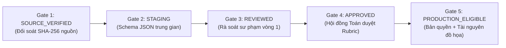

# Báo cáo Sẵn sàng Dữ liệu Toán 12 (Math 12 Data Readiness Report)
## Chuyên đề Trọng điểm: Tính Đơn Điệu của Hàm Số & Lỗi Xét Dấu Đạo Hàm (Hiệu chỉnh Sprint 1.1)

- **Dự án**: Coach Learning (EduMS)
- **Mã Sprint**: SPRINT-01.1
- **Mã tài liệu**: DATA-M12-01
- **Phạm vi dạng bài**: `MONOTONICITY_FROM_EXPRESSION` (Toán 12 GDPT 2018)
- **Trạng thái**: BÁO CÁO THẨM ĐỊNH NGUỒN & QUY CHUẨN DỮ LIỆU ĐÃ HIỆU CHỈNH

---

## 1. Kết quả Kiểm tra Thực tế (Factual Audit Results)

Đã tiến hành kiểm tra trực tiếp và đối soát số liệu trên cả hai nguồn: **Cơ sở dữ liệu PostgreSQL thời gian thực** và **Hệ thống tệp dữ liệu lưu trữ trong repository** (`backend/data/`).

### 1.1. Tình trạng trong Cơ sở dữ liệu Runtime (PostgreSQL Runtime Status)
- **Tổng số câu hỏi trong bảng `questions`**: **0** (Chưa nạp dữ liệu câu hỏi vào production database).
- **Số câu hỏi trạng thái `APPROVED`**: **0**.
- **Số dạng bài Toán 12 đã nạp vào bảng `problem_types`**: **9** (Đầy đủ các mã: `MONOTONICITY_FROM_EXPRESSION`, `PARAMETER_MONOTONICITY`, `FIND_FUNCTION_EXTREMA`, `COMPLETE_FUNCTION_ANALYSIS`...).
- **Số câu hỏi gán cho dạng bài `MONOTONICITY_FROM_EXPRESSION`**: **0**.

### 1.2. Tình trạng trong Tệp Dữ liệu Repository (`backend/data/`)
Trong thư mục `backend/data/questions/math/grade12/derivative_applications_v0_1/`:
- **Tổng số nhóm câu hỏi cấu trúc (Structural Groups)**: 67 nhóm.
- **Số nhóm đã qua rà soát học thuật (Reviewed Groups)**: 67 nhóm.
- **Số nhóm đạt xác minh học thuật (Academic Verified Groups)**: **39 nhóm** (tương ứng 152 câu hỏi con).
- **Chi tiết phân tách 39 nhóm verified**:
  - **38 nhóm sẵn sàng snapshot chuẩn tắc (Canonical Snapshot Ready)**.
  - **1 nhóm bị chặn hiển thị do thiếu ảnh gốc (Visual Blocked)**: `M12_DERIV_GROUP_0012` (thuộc nguồn đề thi thử, đang được cách ly trong danh sách loại trừ phát hành).
- **Số nhóm bị giữ lại để đối soát (Academic Hold)**: 10 nhóm.
- **Số nhóm bị bác bỏ (Academic Rejected)**: 18 nhóm.
- **Tình trạng đủ điều kiện phát hành sản xuất (`production_release_eligible_groups`)**: **0**.
- **Tình trạng sẵn sàng nạp database (`database_import_ready_groups`)**: **0**.

---

## 2. Quy chuẩn Cổng Kiểm soát Dữ liệu (Data Governance & Release Gates)

Mọi dữ liệu câu hỏi đưa vào Solution Engine bắt buộc phải vượt qua 5 cổng kiểm soát chất lượng độc lập. **Nghiêm cấm việc xem dữ liệu REVIEWED hoặc VERIFIED tự động tương đương APPROVED hoặc PRODUCTION_ELIGIBLE**:

| Cổng kiểm duyệt | Tiêu chí bắt buộc | Trạng thái hiện tại đối với kho Toán 12 |
| :--- | :--- | :--- |
| **1. SOURCE_VERIFIED** | Tệp nguồn có mã băm SHA-256 đối soát, xác định rõ nguồn sách/đề thi. | **ĐẠT** (67/67 nhóm có mã băm). |
| **2. STAGING** | Dữ liệu được bóc tách đúng schema JSON trong thư mục `staging/`. | **ĐẠT** (Đầy đủ cấu trúc câu và phương án). |
| **3. REVIEWED** | Giáo viên/chuyên gia đọc duyệt sơ bộ, phân loại verified/hold/reject. | **ĐẠT** (39 nhóm verified, 10 hold, 18 reject). |
| **4. APPROVED** | Lời giải phân bước `SolutionStep`, Bảng xét dấu `SIGN_TABLE` đạt chuẩn, Rubric phân trọng số chi tiết được Hội đồng phê duyệt. | **CHƯA ĐẠT** (38 nhóm verified chỉ có text thô; chưa có cấu trúc bước và rubric). |
| **5. PRODUCTION_ELIGIBLE** | Thẩm định bản quyền tác quyền (Rights Cleared), xác minh tài nguyên đồ họa (0 nhóm lỗi hình), phê duyệt nhập kho. | **0 / 39 (BLOCKED 100%)**. |

---

## 3. Quy mô Question Pool Bắt buộc cho Vòng đời Học tập Hoàn chỉnh

Để vận hành một lát cắt dọc hoàn chỉnh không bị nghẽn nguồn cấp câu hỏi (`BANK_EXHAUSTED`), hệ thống yêu cầu số lượng câu hỏi tối thiểu phân bổ theo từng giai đoạn:

| Phân hệ / Pha học tập | Mục đích sử dụng | Số lượng câu hỏi yêu cầu | Đặc tả cấu trúc |
| :--- | :--- | :---: | :--- |
| **Bài tập Lớp học (Classroom Assignment)** | Đánh giá năng lực giải toán từng bước ban đầu của học sinh. | **6 câu** | Đầy đủ 5 bước giải: TXĐ $\to$ Đạo hàm $\to$ Nghiệm $\to$ Bảng xét dấu $\to$ Kết luận. Có `SolutionRubric` chuẩn. |
| **Kiểm chứng Độc lập (Independent Verification)** | Cô lập kỹ năng xét dấu để kiểm chứng nguyên nhân gốc rễ (loại bỏ gánh nặng tính đạo hàm). | **2 - 3 câu** | Đề bài cho sẵn $f'(x) = a(x-x_1)(x-x_2)$, chỉ yêu cầu xét dấu trên một khoảng cụ thể. |
| **Can thiệp Sửa sai (Adaptive Repair Pool)** | Cung cấp bài tập thích ứng cho các pha `FOUNDATION`, `GUIDED` và `FINAL_RECHECK`. | **8 câu** | Phù hợp chính sách `AdaptiveRepairPolicy` (`max_questions = 8`, `min_attempts_for_resolution = 4`). |
| **Ôn tập Giãn cách (Spaced Review Retrieval)** | Các bài tập gợi nhớ lại kiến thức sau 2 ngày, 4 ngày theo lịch `ReviewSchedule`. | **2 - 3 câu** | Các biến thể hàm số đa thức bậc ba hoặc phân thức bậc nhất/bậc nhất tương đương. |
| **TỔNG CỘNG QUESTION POOL TỐI THIỂU** | Đảm bảo không bị cạn ngân hàng câu hỏi. | **18 - 20 câu** | 100% được gắn thẻ Dạng bài `MONOTONICITY_FROM_EXPRESSION` và Concept `DERIVATIVE`. |

---

## 4. Chuẩn hóa Phân loại Lỗi và Kế hoạch Thẩm định Học thuật

### 4.1. Tình trạng Phân loại Lỗi Xét dấu Đạo hàm
1. **Mã hiện hữu trong hệ thống**: `DERIVATIVE_SIGN_DIRECTION` (Concept `DERIVATIVE`).
   - *Định nghĩa gốc*: "Treats a negative derivative as increasing or a positive derivative as decreasing."
   - *Phạm vi áp dụng*: Chỉ áp dụng khi học sinh suy luận ngược chiều biến thiên từ dấu đạo hàm đã biết.
2. **Mã ứng viên đề xuất bổ sung (Candidate Misconception)**:
   - **Tên mã**: `SIGN_TABLE_QUADRATIC_RULE_INVERTED` (hoặc `DERIVATIVE_INTERVAL_SIGN_ERROR`).
   - **Định nghĩa**: "Đảo ngược dấu của tam thức bậc hai trên các khoảng nghiệm do áp dụng sai quy tắc trong trái ngoài cùng."
   - **Phân loại**: `MisconceptionCategory.PROCEDURAL` / `CONCEPTUAL`.
   - **Trạng thái**: Đang trong diện thẩm định chuyên môn (Domain Review). **Chưa nạp chính thức vào seed database** cho đến khi Hội đồng Sư phạm phê duyệt.

---

## 5. Quy trình Quản lý Bộ Câu hỏi Biên soạn Mới (In-house Authored Items)

Để mở khóa rào cản bản quyền của 39 nhóm bên ngoài, phương án chiến lược là biên soạn bộ câu hỏi nguyên bản thuộc sở hữu của EduMS. Tuy nhiên, các câu hỏi này **phải trải qua đầy đủ quy trình kiểm duyệt nghiêm ngặt, không được tự động cấp quyền phát hành**:

1. **Thông tin Nguồn gốc và Quyền tác giả (Provenance Metadata)**:
   - Tác giả biên soạn: Đội ngũ Chuyên môn Toán EduMS (ghi rõ họ tên tác giả và mã nhân sự).
   - Bản quyền: Thuộc sở hữu 100% của Công ty TNHH Giáo dục EduMS.
   - Trạng thái bản quyền: `RIGHTS_VERIFIED_INTERNAL_ORIGINAL`.
2. **Quy trình Phê duyệt Học thuật**:
   - Vòng 1: Biên soạn đề bài, lời giải mẫu và bảng xét dấu `SIGN_TABLE` JSON.
   - Vòng 2: Phản biện chéo bởi ít nhất 2 giáo viên chuyên môn Toán 12 độc lập.
   - Vòng 3: Ký duyệt biên bản nghiệm thu học thuật (Academic Sign-off).
   - Vòng 4: Cập nhật trạng thái `APPROVED` và cấp phép `PRODUCTION_ELIGIBLE`.

---

## 6. Architecture Decision Record (ADR)

### ADR-05: Tiêu chuẩn Sẵn sàng Dữ liệu Toán 12 và Phân bổ Ngân hàng Câu hỏi

- **Trạng thái**: ĐÃ DUYỆT (ACCEPTED)
- **Quyết định**:
  1. Xác nhận số liệu staging chính xác: 67 nhóm reviewed, 39 nhóm verified (gồm 38 nhóm canonical snapshot ready và 1 nhóm `M12_DERIV_GROUP_0012` visual blocked bị cách ly).
  2. Xác định quy mô ngân hàng câu hỏi tối thiểu là 18-20 câu cho chuyên đề Tính đơn điệu để phục vụ trọn vẹn chu trình Assignment (6), Verification (2-3), Adaptive Repair (8) và Spaced Review (2-3).
  3. Gắn nhãn `SIGN_TABLE_QUADRATIC_RULE_INVERTED` là Candidate Misconception cần qua cổng Domain Review trước khi nạp vào database seed.
  4. Mọi câu hỏi biên soạn nội bộ bắt buộc phải có đầy đủ metadata về tác giả, bản quyền và chữ ký duyệt học thuật trước khi đưa vào sản xuất.
