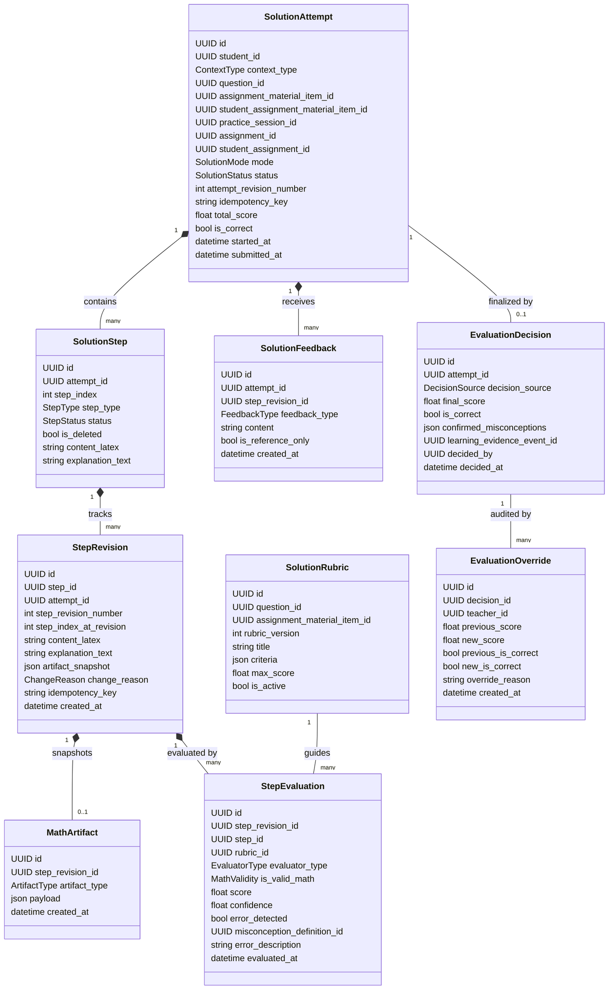

# Thiết kế Hệ thống Giải toán Từng bước (Solution Engine Design)
## Module `backend/app/math_solutions/` (Hiệu chỉnh Kiến trúc Sprint 1.1)


> **Bắt buộc trước migration — STEP-ARCH-00:** [Final Schema & Effective Evidence Safety Gate](STEP_ARCH_00_SAFETY_GATE.md) là quyết định thiết kế ưu tiên nếu các ví dụ SQL/logic bên dưới còn mâu thuẫn. Chưa xác minh PostgreSQL runtime.

- **Dự án**: Coach Learning (EduMS)
- **Mã Sprint**: SPRINT-01.1
- **Phạm vi học thuật đầu tiên**: Toán 12 — Tính đơn điệu của hàm số (Xét dấu đạo hàm)
- **Trạng thái**: THIẾT KẾ KIẾN TRÚC & ĐẶC TẢ ĐỘNG CƠ (ENGINE SPECIFICATION)

---

## 1. Giới thiệu Module `math_solutions`

Module `backend/app/math_solutions/` cung cấp động cơ giải toán tương tác theo từng bước (Step-by-Step Math Solution Engine). Thay vì chỉ nhận chuỗi đáp án thô nguyên khối, module này:
1. Mô hình hóa bài giải thành một chuỗi các bước toán học vi mô (`SolutionStep`).
2. Hỗ trợ đầy đủ **hai nguồn bài tập**:
   - Câu hỏi chuẩn tắc từ Ngân hàng câu hỏi (`Question`).
   - Ảnh chụp câu hỏi bất biến từ tài liệu PDF bóc tách của giáo viên (`AssignmentMaterialItem`), gắn liền với phân quyền lớp học.
3. Cho phép học sinh thêm, sửa, xóa mềm, sắp xếp lại thứ tự bước giải mượt mà, lưu lịch sử phiên bản (`StepRevision`) chống mất dữ liệu khi autosave hoặc gián đoạn mạng.
4. Biểu diễn đối tượng toán học trực quan chuyên biệt (`MathArtifact`: Bảng xét dấu `SIGN_TABLE` và Bảng biến thiên `VARIATION_TABLE`).
5. Cung cấp cơ chế đánh giá 4 tầng (4-Tier Evaluation):
   - Phản hồi tham khảo $\to$ Kiểm chứng toán học tất định (CAS) $\to$ Đánh giá suy luận AI theo Rubric $\to$ Quyết định đánh giá chung cuộc (`EvaluationDecision`).
6. **Bảo toàn tính toàn vẹn của Bằng chứng Học tập và Mastery**:
   - Từng bước giải hoặc bản nháp tuyệt đối không ghi nhận Mastery.
   - Bài làm ban đầu sai được lưu giữ vĩnh viễn kết quả sai; các chu trình can thiệp (Kiểm chứng, Sửa sai, Ôn tập) là các sự kiện độc lập phát sinh bằng chứng riêng.
   - Phân định rõ nguồn bằng chứng chuyên biệt `MATH_SOLUTION_EVALUATION` và cơ chế chống ghi trùng với Assignment v1.

---

## 2. Kiến trúc Thực thể và Luồng Dữ liệu (Domain Entities)



---

## 3. Giải quyết Triệt để Các Yêu cầu Kiến trúc

### 3.1. Hỗ trợ Hai Nguồn Bài tập Bình đẳng (Canonical Question vs Teacher PDF Snapshot)
- **Nguồn 1: Canonical Question (`questions`)**:
  - Dành cho các bài toán chuẩn hóa trong Ngân hàng đề thi của hệ thống.
  - Sử dụng trong tự luyện cá nhân (`SELF_PRACTICE` kèm `practice_session_id`) hoặc bài tập giao từ ngân hàng chung.
  - Rubric liên kết qua trường `math_solution_rubrics.question_id`.
- **Nguồn 2: Teacher Material Item Snapshot (`assignment_material_items`)**:
  - Dành cho câu hỏi tự luận bóc tách từ file PDF/DOCX do giáo viên tải lên.
  - Được đóng băng bất biến trong `assignment_material_items` và gán cho học sinh qua `student_assignment_material_items`.
  - **Không bắt buộc câu hỏi PDF phải xuất bản vào ngân hàng câu hỏi công khai**. Quyền truy cập được bảo vệ nghiêm ngặt theo lớp học thông qua `student_assignments` và `classrooms`.
  - Rubric liên kết trực tiếp qua `math_solution_rubrics.assignment_material_item_id` (phiên bản hóa theo `rubric_version`), đảm bảo chuẩn chấm khớp đúng snapshot đã giao.
- **Ràng buộc loại trừ**: Ràng buộc `CHECK (chk_solution_source_exclusive)` bảo đảm một attempt chỉ trỏ về đúng một nguồn duy nhất.

---

### 3.2. Quản lý Bước giải, Sắp xếp và Chống Xung đột Unique Index
- **Thao tác Thêm / Sửa / Xóa mềm**:
  - Thêm bước: tạo `SolutionStep` mới với `step_index` phù hợp và tạo bản ghi `StepRevision(step_revision_number=1)`.
  - Sửa bước: cập nhật nội dung và tạo `StepRevision(step_revision_number = n+1)`.
  - Xóa mềm: đánh dấu `is_deleted = true`, giải phóng `step_index` trên partial index để không cản trở việc chèn bước mới.
- **Cơ chế Reorder không gây lỗi vi phạm Unique Constraint**:
  - Chỉ mục duy nhất trên bảng `math_solution_steps`:
    ```sql
    CREATE UNIQUE INDEX uq_math_solution_step_active_index 
    ON math_solution_steps(attempt_id, step_index) 
    WHERE is_deleted = FALSE 
    NON-DEFERRABLE (partial unique index; immediate uniqueness check);
    ```
  - Trong một transaction đổi vị trí (ví dụ swap bước 1 và bước 2): Postgres trì hoãn kiểm tra ràng buộc duy nhất cho đến khi lệnh `COMMIT` được gọi.
  - Tầng service bổ sung phương án phòng thủ **Two-Phase Reindexing**: gán chỉ số tạm DƯƠNG duy nhất lớn hơn mọi index hiện có và index đích, flush, sau đó chuyển về thứ tự 1..N trong cùng transaction đã khóa SolutionAttempt.

---

### 3.3. Đánh giá Bước giải Bất biến (Revision-bound Step Evaluation)
- **Nguyên lý**: Bước giải `SolutionStep` là thực thể khả biến (học sinh có thể sửa nội dung liên tục). Nếu kết quả đánh giá trỏ vào `step_id`, kết quả chấm sẽ bị sai lệch khi học sinh sửa code LaTeX.
- **Giải pháp**:
  - `StepEvaluation` **bắt buộc trỏ khóa ngoại vào `step_revision_id`** của bảng `math_step_revisions`.
  - Mỗi bản ghi đánh giá gắn chặt với một ảnh chụp bất biến cụ thể của lời giải và bảng xét dấu.
- **Mở rộng Trạng thái Kiểm chứng Toán học (`is_valid_math`)**:
  - Thay vì kiểu boolean nhị phân (`true/false`), trường `is_valid_math` là enum 4 trạng thái:
    1. `VALID`: Biểu thức toán học cú pháp chuẩn và suy luận toán học chính xác.
    2. `INVALID`: Sai sót toán học hoặc vi phạm quy tắc suy luận logic.
    3. `UNDETERMINED`: Bộ parser hoặc CAS hình thức không thể xác định (ví dụ: biểu thức vượt ngoài tập quy tắc, timeout tính toán).
    4. `NEEDS_REVIEW`: Biểu thức có dấu hiệu mơ hồ, cần chuyển tiếp cho giáo viên hoặc mô hình AI cấp cao hơn thẩm định.

---

### 3.4. Mô hình Bằng chứng Bất biến & Chống Ghi trùng với Assignment v1

#### A. Ràng buộc Kiến trúc Resolver Hiện tại
Trong `backend/app/knowledge_gap/evidence_context.py`:
- Resolver hiện chỉ hỗ trợ 3 nguồn:
  - `PRACTICE_QUESTION` $\to$ Bắt buộc đọc `QuestionAttempt`.
  - `ASSIGNMENT_CANONICAL_QUESTION` $\to$ Bắt buộc đọc `AssignmentStudentQuestion`.
  - `TEACHER_MATERIAL_ITEM` $\to$ Bắt buộc đọc `StudentAssignmentMaterialItem`.
- **Nghiêm cấm**: Không được tái sử dụng `PRACTICE_QUESTION` với `source_entity_id = EvaluationDecision.id` vì resolver sẽ gọi `session.get(QuestionAttempt, decision.id) == None` và ném lỗi `ApplicationError(409, "EVIDENCE_SOURCE_CONTEXT_MISSING")`.

#### B. Đề xuất Nguồn Bằng chứng Mới: `MATH_SOLUTION_EVALUATION`
1. **Mở rộng Enum**: Bổ sung `MATH_SOLUTION_EVALUATION` vào `LearningEvidenceSourceKind`.
2. **Cập nhật `LearningEvidenceContextResolver`**:
   ```python
   if event.source_kind == LearningEvidenceSourceKind.MATH_SOLUTION_EVALUATION:
       decision = self.session.get(EvaluationDecision, event.source_entity_id)
       if decision is None:
           raise self._source_missing()
       attempt = self.session.get(SolutionAttempt, decision.attempt_id)
       if attempt is None or attempt.student_id != event.student_id:
           raise self._source_missing()
       
       # Nhánh 1: Canonical Question
       if attempt.question_id is not None:
           question = self.session.get(Question, attempt.question_id)
           return DiagnosticEvidenceContext(
               **base,
               student_response=self._serialize_attempt_summary(attempt),
               content=question.content,
               expected_answer=question.correct_answer,
               explanation=question.explanation,
               canonical_question=question,
           )
       # Nhánh 2: Teacher Material Item Snapshot
       if attempt.assignment_material_item_id is not None:
           snapshot = self.session.get(AssignmentMaterialItem, attempt.assignment_material_item_id)
           return DiagnosticEvidenceContext(
               **base,
               student_response=self._serialize_attempt_summary(attempt),
               content=snapshot.content or "",
               expected_answer=snapshot.correct_answer,
               explanation=snapshot.explanation,
               assignment_material_snapshot_id=snapshot.id,
           )
   ```

#### C. Chống Ghi trùng Bằng chứng với Assignment v1 (Double-Counting Prevention)
Khi học sinh làm bài tập giải từng bước trong một bài tập lớp (`CLASSROOM_ASSIGNMENT`):
- **Quy tắc duy nhất**: Chỉ phát sinh **đúng 1 sự kiện `LearningEvidenceEvent`** thông qua `EvaluationDecision` với `source_kind = MATH_SOLUTION_EVALUATION`.
- Quy trình nộp bài Assignment v1 thông thường sẽ kiểm tra xem câu hỏi đó có `SolutionAttempt` liên kết hay không:
  - Nếu câu hỏi đã được giải và chấm qua Solution Engine: hệ thống cập nhật trường `score` và `student_answer` trên `AssignmentStudentQuestion` / `StudentAssignmentMaterialItem` nhưng **tuyệt đối KHÔNG phát sinh thêm sự kiện `ASSIGNMENT_CANONICAL_QUESTION` hoặc `TEACHER_MATERIAL_ITEM`**.
  - Nhờ vậy, điểm năng lực Mastery và lịch sử chẩn đoán chỉ ghi nhận một luồng bằng chứng duy nhất.

#### D. Teacher regrade — effective-evidence projection
- `LearningEvidenceEvent` cũ là immutable ledger. Giáo viên sửa điểm chỉ append audit vào `math_evaluation_overrides`; **không emit corrective LearningEvidenceEvent như một lần làm mới**.
- Với mỗi sự kiện gốc, effective score/correctness lấy bản override có thẩm quyền mới nhất. Under student row lock, rebuild/replay các sự kiện có hiệu lực theo thứ tự ổn định từ clean state (hoặc snapshot được kiểm chứng), giữ nguyên số lượt, weights, hints, difficulty, timestamps; reconcile ReviewSchedule. Trường hợp chưa có safe replay thì correction PENDING, không sửa Mastery.
- Tests: 0.4 -> 1.0 -> 0.7 cùng một attempt vẫn count=1, retries không double count; verification/repair thực vẫn có attempt/evidence độc lập.
- SQLAlchemy before_update/delete hooks không bảo vệ khỏi direct SQL; cần chính sách DB role/trigger tương ứng.

---

### 3.5. Công thức Tính toán Mastery Chuẩn xác (Loại bỏ Số liệu Hardcode)

Hệ thống tính toán Mastery **không sử dụng bất kỳ giá trị hardcode nào** (như 75% hay confidence 72%). Tất cả đều tuân thủ chính xác công thức từ `DeterministicMasteryCalculationStrategy` (`backend/app/mastery/strategy.py`):

1. **Khi học sinh làm sai bài giải ban đầu** (`score = 0.40`, `is_correct = False`, `hint_count = 0`):
   - Hệ số độ khó: $\text{difficulty\_factor} = 1.1 - 0.3 \times \text{difficulty}$.
   - Tốc độ tăng trưởng: $\text{mastery\_rate} = \min(0.3, 0.22 \times \text{weight} \times \text{difficulty\_factor} \times 1.0)$.
   - Điểm Mastery mới:
     $$\text{mastery\_score}_{\text{new}} = \text{mastery\_score}_{\text{prev}} + \text{mastery\_rate} \times (0.40 - \text{mastery\_score}_{\text{prev}})$$
   - Độ tự tin mới:
     $$\text{confidence\_gain} = 0.13 \times (0.5 + 0.5 \times \text{weight}) \times 1.0 \times (0.9 + 0.1 \times \text{difficulty})$$
     $$\text{confidence}_{\text{new}} = \text{confidence}_{\text{prev}} + \text{confidence\_gain} \times (1.0 - \text{confidence}_{\text{prev}})$$
2. **Quy tắc xác định trạng thái hiển thị (`derive_mastery_state` trong `app.mastery.state`)**:
   - `NOT_STARTED`: `attempt_count == 0`.
   - `MASTERED`: `mastery_score >= 0.8` VÀ `confidence >= 0.65` (nếu cách lần luyện cuối $\ge 14$ ngày $\to$ chuyển thành `REVIEW_DUE`).
   - `WEAK`: `mastery_score < 0.4` VÀ `confidence >= 0.25`.
   - `PRACTICING`: `attempt_count >= 3` HOẶC `mastery_score >= 0.55`.
   - `LEARNING`: các trường hợp còn lại.

---

### 3.6. Concurrency, Khóa Ghi và Bảo mật Rubric
1. **Phân định rõ 2 bộ đếm Revision**:
   - `attempt_revision_number` (trên `SolutionAttempt`): Đếm phiên bản toàn phiên, phục vụ Khóa lạc quan chống ghi đè đồng thời từ hai client.
   - `step_revision_number` (trên `StepRevision`): Đếm phiên bản riêng của từng bước giải logic, phục vụ tính năng rollback bước.
2. **Khóa chống trùng lặp (Idempotency Keys)**:
   - Client gửi `idempotency_key` trong header hoặc payload của mọi request thêm bước, sửa bước, reorder.
   - Nếu client bị gián đoạn mạng và gửi lại request cũ, database chặn trùng lặp qua partial unique index và trả về kết quả đã xử lý.
3. **Khóa ghi sau khi nộp (Post-Submit Write Lock)**:
   - Khi bài làm chuyển sang `SUBMITTED` hoặc `EVALUATED`, mọi API sửa đổi từ phía học sinh bị khóa cứng (HTTP 403 Forbidden).
4. **Bảo mật tiêu chí Rubric**:
   - Trường `criteria` của `SolutionRubric` bị ẩn hoàn toàn đối với học sinh cho đến khi hoàn tất nộp bài hoặc được mở theo giàn giáo có kiểm soát trong chế độ `GUIDED_LEARNING`.

---

## 4. Đặc tả Lược đồ Cơ sở Dữ liệu Đề xuất (SQL Draft)

```sql
-- 1. Bảng SolutionAttempt (Hỗ trợ 2 nguồn bài tập)
CREATE TABLE math_solution_attempts (
    id UUID PRIMARY KEY DEFAULT gen_random_uuid(),
    student_id UUID NOT NULL REFERENCES student_profiles(id) ON DELETE RESTRICT,
    context_type VARCHAR(50) NOT NULL CHECK (context_type IN ('SELF_PRACTICE', 'CLASSROOM_ASSIGNMENT')),
    question_id UUID REFERENCES questions(id) ON DELETE RESTRICT,
    assignment_material_item_id UUID REFERENCES assignment_material_items(id) ON DELETE RESTRICT,
    student_assignment_material_item_id UUID REFERENCES student_assignment_material_items(id) ON DELETE CASCADE,
    practice_session_id UUID REFERENCES practice_sessions(id) ON DELETE SET NULL,
    assignment_id UUID REFERENCES assignments(id) ON DELETE CASCADE,
    student_assignment_id UUID REFERENCES student_assignments(id) ON DELETE CASCADE,
    assignment_student_question_id UUID REFERENCES assignment_student_questions(id) ON DELETE RESTRICT,
    mode VARCHAR(50) NOT NULL CHECK (mode IN ('GUIDED_LEARNING', 'INDEPENDENT_SOLUTION')),
    status VARCHAR(50) NOT NULL DEFAULT 'DRAFT' CHECK (status IN ('DRAFT', 'IN_PROGRESS', 'SUBMITTED', 'EVALUATED', 'ABANDONED')),
    attempt_revision_number INT NOT NULL DEFAULT 1,
    idempotency_key VARCHAR(100),
    total_score DOUBLE PRECISION CHECK (total_score IS NULL OR (total_score >= 0.0 AND total_score <= 1.0)),
    is_correct BOOLEAN,
    started_at TIMESTAMPTZ NOT NULL DEFAULT NOW(),
    submitted_at TIMESTAMPTZ,
    evaluated_at TIMESTAMPTZ,
    created_at TIMESTAMPTZ NOT NULL DEFAULT NOW(),
    updated_at TIMESTAMPTZ NOT NULL DEFAULT NOW(),
    CONSTRAINT chk_solution_source_exclusive CHECK (
        (question_id IS NOT NULL AND assignment_material_item_id IS NULL AND student_assignment_material_item_id IS NULL) OR
        (question_id IS NULL AND assignment_material_item_id IS NOT NULL AND student_assignment_material_item_id IS NOT NULL)
    ),
    CONSTRAINT chk_solution_context_alignment CHECK (
        (context_type = 'SELF_PRACTICE' AND practice_session_id IS NOT NULL AND assignment_id IS NULL AND student_assignment_id IS NULL AND question_id IS NOT NULL) OR
        (context_type = 'CLASSROOM_ASSIGNMENT' AND assignment_id IS NOT NULL AND student_assignment_id IS NOT NULL)
    )
);

CREATE UNIQUE INDEX uq_math_solution_attempts_idempotency ON math_solution_attempts(student_id, idempotency_key) WHERE idempotency_key IS NOT NULL;
CREATE INDEX ix_math_solution_attempts_student ON math_solution_attempts(student_id, started_at);
CREATE INDEX ix_math_solution_attempts_question ON math_solution_attempts(question_id, status) WHERE question_id IS NOT NULL;
CREATE INDEX ix_math_solution_attempts_material ON math_solution_attempts(assignment_material_item_id, status) WHERE assignment_material_item_id IS NOT NULL;

-- 2. Bảng SolutionStep
CREATE TABLE math_solution_steps (
    id UUID PRIMARY KEY DEFAULT gen_random_uuid(),
    attempt_id UUID NOT NULL REFERENCES math_solution_attempts(id) ON DELETE CASCADE,
    step_index INT NOT NULL CHECK (step_index >= 1),
    step_type VARCHAR(50) NOT NULL CHECK (step_type IN ('ASSUMPTION', 'DERIVATIVE_CALCULATION', 'ROOT_FINDING', 'SIGN_TABLE', 'VARIATION_TABLE', 'CONCLUSION', 'EXPLANATION', 'CUSTOM')),
    status VARCHAR(50) NOT NULL DEFAULT 'ACTIVE' CHECK (status IN ('DRAFT', 'ACTIVE', 'DELETED')),
    is_deleted BOOLEAN NOT NULL DEFAULT FALSE,
    content_latex TEXT NOT NULL,
    explanation_text TEXT,
    created_at TIMESTAMPTZ NOT NULL DEFAULT NOW(),
    updated_at TIMESTAMPTZ NOT NULL DEFAULT NOW()
);

CREATE UNIQUE INDEX uq_math_solution_step_active_index ON math_solution_steps(attempt_id, step_index) WHERE is_deleted = FALSE;
CREATE INDEX ix_math_solution_steps_attempt ON math_solution_steps(attempt_id, step_index);

-- 3. Bảng StepRevision
CREATE TABLE math_step_revisions (
    id UUID PRIMARY KEY DEFAULT gen_random_uuid(),
    step_id UUID NOT NULL REFERENCES math_solution_steps(id) ON DELETE CASCADE,
    attempt_id UUID NOT NULL REFERENCES math_solution_attempts(id) ON DELETE CASCADE,
    step_revision_number INT NOT NULL CHECK (step_revision_number >= 1),
    step_index_at_revision INT NOT NULL,
    content_latex TEXT NOT NULL,
    explanation_text TEXT,
    artifact_snapshot JSONB,
    change_reason VARCHAR(50) NOT NULL CHECK (change_reason IN ('STUDENT_EDIT', 'STUDENT_REORDER', 'AUTOSAVE', 'ROLLBACK')),
    idempotency_key VARCHAR(100),
    created_at TIMESTAMPTZ NOT NULL DEFAULT NOW(),
    CONSTRAINT uq_math_step_revisions_step_rev UNIQUE (step_id, step_revision_number)
);

CREATE UNIQUE INDEX uq_math_step_revisions_idempotency ON math_step_revisions(step_id, idempotency_key) WHERE idempotency_key IS NOT NULL;

-- 4. Bảng MathArtifact (Gắn chặt với StepRevision)
CREATE TABLE math_artifacts (
    id UUID PRIMARY KEY DEFAULT gen_random_uuid(),
    step_revision_id UUID NOT NULL UNIQUE REFERENCES math_step_revisions(id) ON DELETE CASCADE,
    artifact_type VARCHAR(50) NOT NULL CHECK (artifact_type IN ('SIGN_TABLE', 'VARIATION_TABLE', 'INTERVAL_SET', 'SYSTEM_OF_EQUATIONS')),
    payload JSONB NOT NULL,
    created_at TIMESTAMPTZ NOT NULL DEFAULT NOW()
);

-- 5. Bảng SolutionRubric (Hỗ trợ cả Canonical và Teacher Material Item)
CREATE TABLE math_solution_rubrics (
    id UUID PRIMARY KEY DEFAULT gen_random_uuid(),
    question_id UUID REFERENCES questions(id) ON DELETE CASCADE,
    assignment_material_item_id UUID REFERENCES assignment_material_items(id) ON DELETE CASCADE,
    rubric_version INT NOT NULL DEFAULT 1,
    title VARCHAR(255) NOT NULL,
    criteria JSONB NOT NULL,
    max_score DOUBLE PRECISION NOT NULL DEFAULT 1.0 CHECK (max_score > 0),
    is_active BOOLEAN NOT NULL DEFAULT TRUE,
    created_at TIMESTAMPTZ NOT NULL DEFAULT NOW(),
    CONSTRAINT chk_rubric_target_exclusive CHECK (
        (question_id IS NOT NULL AND assignment_material_item_id IS NULL) OR
        (question_id IS NULL AND assignment_material_item_id IS NOT NULL)
    )
);

CREATE UNIQUE INDEX uq_rubric_canonical ON math_solution_rubrics(question_id, rubric_version) WHERE question_id IS NOT NULL;
CREATE UNIQUE INDEX uq_rubric_material ON math_solution_rubrics(assignment_material_item_id, rubric_version) WHERE assignment_material_item_id IS NOT NULL;

-- 6. Bảng StepEvaluation (Gắn với StepRevision và mở rộng 4 trạng thái CAS)
CREATE TABLE math_step_evaluations (
    id UUID PRIMARY KEY DEFAULT gen_random_uuid(),
    step_revision_id UUID NOT NULL REFERENCES math_step_revisions(id) ON DELETE CASCADE,
    step_id UUID NOT NULL REFERENCES math_solution_steps(id) ON DELETE CASCADE,
    rubric_id UUID REFERENCES math_solution_rubrics(id) ON DELETE SET NULL,
    evaluator_type VARCHAR(50) NOT NULL CHECK (evaluator_type IN ('DETERMINISTIC_RULES', 'AI_HEURISTIC', 'TEACHER')),
    is_valid_math VARCHAR(20) NOT NULL CHECK (is_valid_math IN ('VALID', 'INVALID', 'UNDETERMINED', 'NEEDS_REVIEW')),
    score DOUBLE PRECISION NOT NULL CHECK (score >= 0.0 AND score <= 1.0),
    confidence DOUBLE PRECISION NOT NULL CHECK (confidence >= 0.0 AND confidence <= 1.0),
    error_detected BOOLEAN NOT NULL DEFAULT FALSE,
    misconception_definition_id UUID REFERENCES misconception_definitions(id) ON DELETE SET NULL,
    error_description TEXT,
    evidence_quote TEXT,
    evaluated_at TIMESTAMPTZ NOT NULL DEFAULT NOW()
);

CREATE INDEX ix_math_step_evaluations_revision ON math_step_evaluations(step_revision_id, evaluator_type);

-- 7. Bảng SolutionFeedback
CREATE TABLE math_solution_feedbacks (
    id UUID PRIMARY KEY DEFAULT gen_random_uuid(),
    attempt_id UUID NOT NULL REFERENCES math_solution_attempts(id) ON DELETE CASCADE,
    step_revision_id UUID REFERENCES math_step_revisions(id) ON DELETE SET NULL,
    feedback_type VARCHAR(50) NOT NULL CHECK (feedback_type IN ('REFERENCE_HINT', 'SOCRATIC_QUESTION', 'VERIFICATION_ALERT', 'ERROR_CORRECTION')),
    content TEXT NOT NULL,
    is_reference_only BOOLEAN NOT NULL DEFAULT TRUE,
    created_at TIMESTAMPTZ NOT NULL DEFAULT NOW()
);

-- 8. Bảng EvaluationDecision (Quyết định chung cuộc, phát sinh bằng chứng duy nhất)
CREATE TABLE math_evaluation_decisions (
    id UUID PRIMARY KEY DEFAULT gen_random_uuid(),
    attempt_id UUID NOT NULL UNIQUE REFERENCES math_solution_attempts(id) ON DELETE CASCADE,
    decision_source VARCHAR(50) NOT NULL CHECK (decision_source IN ('AUTOMATED_CONSENSUS', 'TEACHER_OVERRIDE', 'AUDIT_APPROVED')),
    final_score DOUBLE PRECISION NOT NULL CHECK (final_score >= 0.0 AND final_score <= 1.0),
    is_correct BOOLEAN NOT NULL,
    confirmed_misconceptions JSONB NOT NULL DEFAULT '[]'::jsonb,
    learning_evidence_event_id UUID REFERENCES learning_evidence_events(id) ON DELETE SET NULL,
    decided_by UUID REFERENCES users(id) ON DELETE SET NULL,
    decided_at TIMESTAMPTZ NOT NULL DEFAULT NOW()
);

-- 9. Bảng EvaluationOverride (Lịch sử audit của Giáo viên)
CREATE TABLE math_evaluation_overrides (
    id UUID PRIMARY KEY DEFAULT gen_random_uuid(),
    decision_id UUID NOT NULL REFERENCES math_evaluation_decisions(id) ON DELETE CASCADE,
    teacher_id UUID NOT NULL REFERENCES users(id) ON DELETE RESTRICT,
    previous_score DOUBLE PRECISION NOT NULL,
    new_score DOUBLE PRECISION NOT NULL,
    previous_is_correct BOOLEAN NOT NULL,
    new_is_correct BOOLEAN NOT NULL,
    override_reason TEXT NOT NULL,
    corrective_evidence_event_id UUID REFERENCES learning_evidence_events(id) ON DELETE SET NULL,
    created_at TIMESTAMPTZ NOT NULL DEFAULT NOW()
);
```

---

## 5. Architecture Decision Record (ADR)

### ADR-03: Thiết kế Động cơ Giải toán Từng bước Hoàn chỉnh

- **Trạng thái**: ĐÃ DUYỆT (ACCEPTED)
- **Quyết định**:
  1. Tách biệt hoàn toàn `attempt_revision_number` (optimistic lock cấp phiên) và `step_revision_number` (lịch sử rollback từng bước).
  2. Bắt buộc gắn kết `StepEvaluation` vào `StepRevision` bất biến.
  3. Mở rộng `is_valid_math` thành 4 trạng thái để xử lý triệt để các hạn chế của bộ parser/CAS toán học.
  4. Đề xuất nguồn bằng chứng chuyên biệt `MATH_SOLUTION_EVALUATION` và tích hợp vào `LearningEvidenceContextResolver` cho cả 2 nhánh đề bài, đảm bảo chống ghi trùng với Assignment v1.
  5. Thiết lập bảng `math_evaluation_overrides` bảo vệ tính toàn vẹn append-only của `learning_evidence_events`.


---
### STEP-ARCH-00 — implementation overrides
Không dùng SQL `DEFERRABLE` cho partial unique index, cũng không dùng temporary negative step indexes. Thêm `math_solution_operations` (bảng thứ 10) để idempotency thực sự cho mọi mutation. Correction trong `math_evaluation_overrides` chỉ điều chỉnh effective-evidence projection và rebuild/reconcile Mastery + Review, không tạo lần học mới. Ưu tiên [safety gate](STEP_ARCH_00_SAFETY_GATE.md).
