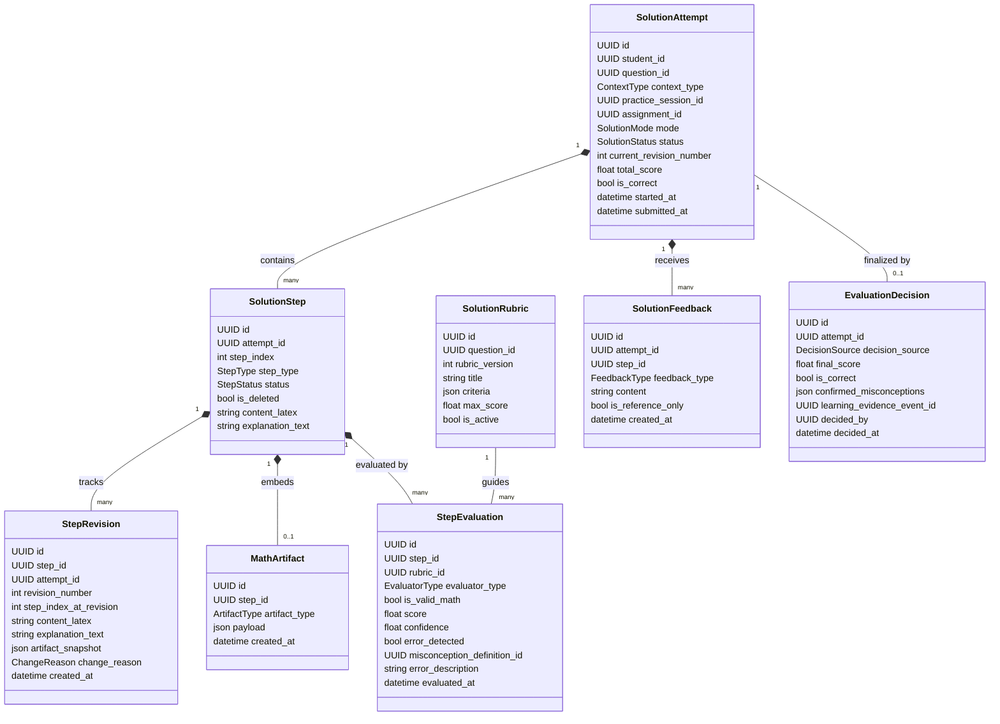

# Thiết kế Hệ thống Giải toán Từng bước (Solution Engine Design)
## Module `backend/app/math_solutions/`

- **Dự án**: Coach Learning (EduMS)
- **Mã Sprint**: SPRINT-01 (ARCH-01 + DATA-READY-01)
- **Phạm vi học thuật đầu tiên**: Toán 12 — Tính đơn điệu của hàm số (Xét dấu đạo hàm)
- **Trạng thái**: THIẾT KẾ KIẾN TRÚC & ĐỀ XUẤT SCHEMA (CHƯA CHẠY MIGRATION)

---

## 1. Giới thiệu Module `math_solutions`

Module `backend/app/math_solutions/` được thiết kế nhằm mục đích cung cấp một động cơ giải toán tương tác theo từng bước (Step-by-Step Math Solution Engine). Thay vì chỉ nhận chuỗi đáp án thô của học sinh, module này cho phép:
- Mô hình hóa lời giải thành một chuỗi các bước toán học vi mô (`SolutionStep`).
- Hỗ trợ học sinh chỉnh sửa, thêm, xóa mềm, thay đổi thứ tự bước linh hoạt.
- Biểu diễn công thức toán học (LaTeX) và các cấu trúc dữ liệu toán học chuyên biệt như Bảng xét dấu (`SIGN_TABLE`) và Bảng biến thiên (`VARIATION_TABLE`).
- Quản lý phiên bản (`StepRevision`) giúp chống mất dữ liệu khi autosave hoặc chỉnh sửa đồng thời, đồng thời cho phép khôi phục (rollback) trạng thái bài làm.
- Cung cấp cơ chế đánh giá 4 tầng (4-Tier Evaluation): Phản hồi tham khảo $\to$ Kiểm chứng toán học $\to$ Đánh giá AI $\to$ Quyết định chấm cuối cùng.

---

## 2. Kiến trúc Thực thể Cốt lõi (Domain Entities)

Hệ thống bao gồm 8 thực thể chính:



---

## 3. Giải quyết 9 Yêu cầu Thiết kế Cốt lõi

### Yêu cầu 1: Một bài toán có nhiều bước và nhiều lời giải hợp lệ
- **Vấn đề**: Trong toán học (đặc biệt là Tính đơn điệu), một bài toán có thể giải theo nhiều hướng:
  - *Hướng 1 (Chuẩn tắc)*: Tập xác định $\to$ Tính đạo hàm $y'$ $\to$ Tìm nghiệm $y'=0$ $\to$ Bảng xét dấu đạo hàm $\to$ Kết luận khoảng đơn điệu.
  - *Hướng 2 (Dùng giá trị thử - Test points)*: Tính đạo hàm $\to$ Thay giá trị đại diện trên từng khoảng để xác định dấu $\to$ Kết luận.
  - *Hướng 3 (Biến đổi đại số)*: Đánh giá trực tiếp dấu của biểu thức đạo hàm (ví dụ: bình phương luôn không âm).
- **Giải pháp**:
  - `SolutionRubric` định nghĩa nhiều `AlternativeSolutionPath`. Mỗi path chứa tập hợp các tiêu chí cần đạt tương ứng.
  - `StepEvaluation` nhận diện bước giải hiện tại khớp với nhánh giải nào, không ép buộc học sinh phải đi theo một chuỗi bước máy móc.

### Yêu cầu 2: Học sinh có thể thêm, sửa, xóa, sắp xếp bước
- **Thêm bước**: Học sinh thêm bước tại vị trí bất kỳ; các bước phía sau được tăng `step_index`.
- **Sửa bước**: Cập nhật nội dung LaTeX hoặc giải thích; tự động lưu một bản ghi `StepRevision` mới.
- **Xóa bước (Soft Delete)**: Đánh dấu `is_deleted = true`, ẩn khỏi giao diện bài làm nhưng vẫn lưu trong lịch sử để có thể khôi phục hoặc xem lại quá trình tư duy của học sinh.
- **Sắp xếp lại bước**: Hỗ trợ kéo thả trên giao diện. Thao tác reorder gửi mảng `[ { step_id, new_step_index } ]`, cập nhật lại vị trí hiển thị và ghi nhận `change_reason = STUDENT_REORDER` trong `StepRevision`.

### Yêu cầu 3: Hỗ trợ công thức toán, bảng xét dấu, bảng biến thiên và giải thích bằng lời
Mỗi `SolutionStep` kết hợp:
1. `content_latex`: Biểu thức toán học dạng LaTeX chuẩn (ví dụ: `y' = x^2 - 2x - 3`).
2. `explanation_text`: Lời giải thích tự nhiên của học sinh (ví dụ: "Xét dấu tam thức bậc hai bằng quy tắc trong trái ngoài cùng").
3. `MathArtifact` (nếu bước thuộc loại bảng):
   - **`SIGN_TABLE` (Bảng xét dấu)**: Cấu trúc JSON chuẩn hóa:
     ```json
     {
       "variable": "x",
       "row_expression": "y'",
       "intervals": [
         { "label": "-inf", "value": null },
         { "label": "-1", "value": -1, "sign_at": "0" },
         { "label": "3", "value": 3, "sign_at": "0" },
         { "label": "+inf", "value": null }
       ],
       "signs": [
         { "from": "-inf", "to": "-1", "sign": "+" },
         { "from": "-1", "to": "3", "sign": "-" },
         { "from": "3", "to": "+inf", "sign": "+" }
       ]
     }
     ```
   - **`VARIATION_TABLE` (Bảng biến thiên)**: Mở rộng từ bảng xét dấu, bổ sung hàng giá trị $y$ và chiều mũi tên biến thiên (`UP`, `DOWN`).

### Yêu cầu 4: Lưu revision và có thể khôi phục bài làm (Rollback)
- Mỗi lần chỉnh sửa bước hoặc autosave, hệ thống tạo một bản ghi `StepRevision` với `revision_number = current_revision_number + 1`.
- `artifact_snapshot` lưu toàn bộ trạng thái bảng xét dấu tại thời điểm đó.
- Khi học sinh muốn khôi phục lại trạng thái cũ, hệ thống tạo bản ghi revision mới mang cờ `change_reason = ROLLBACK`, sao chép dữ liệu từ revision được chỉ định mà không xóa lịch sử cũ (bảo toàn tính audit).

### Yêu cầu 5: Hỗ trợ cả `SELF_PRACTICE` và `CLASSROOM_ASSIGNMENT`
- Trường `context_type` trong `SolutionAttempt` phân định rõ:
  - `SELF_PRACTICE`: Đi kèm `practice_session_id` trỏ về bảng `practice_sessions`. Học sinh tự học trên Knowledge Forest hoặc trang tự luyện.
  - `CLASSROOM_ASSIGNMENT`: Đi kèm `assignment_id` và `student_assignment_id` trỏ về bảng `assignments` và `student_assignments`. Giáo viên có thể xem tiến độ và chấm bài.
- Ràng buộc toàn vẹn cơ sở dữ liệu (`CHECK` constraint) đảm bảo:
  `context_type = 'SELF_PRACTICE' AND practice_session_id IS NOT NULL AND assignment_id IS NULL` HOẶC
  `context_type = 'CLASSROOM_ASSIGNMENT' AND assignment_id IS NOT NULL AND practice_session_id IS NULL`.

### Yêu cầu 6: Phân biệt `GUIDED_LEARNING` và `INDEPENDENT_SOLUTION`
- **`GUIDED_LEARNING` (Học có giàn giáo)**:
  - Sau khi học sinh hoàn thành mỗi bước, hệ thống có thể chạy `StepEvaluation` tức thì.
  - Cung cấp gợi ý dẫn dắt sư phạm (`SolutionFeedback`) dạng câu hỏi gợi mở (Socratic hint) nếu bước đó sai, giúp học sinh tự sửa lỗi ngay tại chỗ.
  - Thích hợp cho học sinh đang ở trạng thái `WEAK`, `LEARNING` hoặc trong phase `GUIDED` của lộ trình `AdaptiveRepair`.
- **`INDEPENDENT_SOLUTION` (Làm bài độc lập / Kiểm tra)**:
  - Hệ thống chỉ lưu trữ và hỗ trợ học sinh biên soạn bước mà **không đưa ra bất kỳ phản hồi hay chấm điểm nào giữa chừng**.
  - Chỉ khi học sinh bấm "Nộp bài", toàn bộ bài giải mới được chuyển sang trạng thái `SUBMITTED` và kích hoạt quá trình đánh giá tổng thể.
  - Thích hợp cho bài tập lớp có tính điểm, bài kiểm tra hoặc phase `FINAL_RECHECK` của sửa sai.

### Yêu cầu 7: Không dùng bản nháp hoặc mỗi bước giải làm bằng chứng Mastery độc lập
- **Nguyên tắc an toàn dữ liệu**:
  - Các bước giải `SolutionStep` hoặc các lần sửa nháp `StepRevision` **tuyệt đối không được phát sinh sự kiện `LearningEvidenceEvent`**.
  - Một học sinh có thể gõ thử nghiệm, xóa đi viết lại nhiều lần — điều này không phản ánh rằng học sinh liên tục thành thạo rồi lại yếu.
  - Chỉ khi toàn bộ `SolutionAttempt` được nộp và một `EvaluationDecision` được ban hành chính thức (xác nhận điểm toàn bài và các quan niệm sai lầm cụ thể), hệ thống mới phát sinh **duy nhất một sự kiện bằng chứng học tập** (`LearningEvidenceEvent`) vào bảng `learning_evidence_events`.
  - Nhờ vậy, điểm số trên Knowledge Forest và Mastery Engine luôn phản ánh kết quả học tập chân thực, không bị nhiễu.

### Yêu cầu 8: Cơ chế Đánh giá 4 Tầng (4-Tier Evaluation Framework)
Hệ thống phân tách rạch ròi 4 cấp độ đánh giá:
1. **Tầng 1 — Phản hồi tham khảo (`SolutionFeedback`)**:
   - Gợi ý cách làm, câu hỏi sư phạm, cảnh báo nhắc nhở.
   - Có cờ `is_reference_only = true`. Hoàn toàn không ảnh hưởng đến điểm số của học sinh.
2. **Tầng 2 — Kiểm chứng toán học tất định (Deterministic Math Verification)**:
   - Sử dụng bộ parser toán học kiểm tra tính hợp lệ cú pháp, cân bằng ngoặc, tập xác định, và kiểm tra tính nhất quán toán học (ví dụ: kiểm tra xem đạo hàm của $f(x)$ có thực sự bằng biểu thức học sinh gõ hay không bằng cách tính đạo hàm hình thức).
   - Xác nhận `is_valid_math = true/false` một cách khách quan, không phụ thuộc vào AI.
3. **Tầng 3 — Đánh giá suy luận AI (`StepEvaluation` qua `AIGateway`)**:
   - Đối chiếu bước giải với `SolutionRubric` để nhận diện học sinh đang giải theo phương pháp nào, bước giải đã giải quyết được tiêu chí nào của bài toán, và có dấu hiệu của quan niệm sai lầm cụ thể (như `DERIVATIVE_SIGN_DIRECTION`) hay không.
   - Trả về `score`, `confidence`, và `evidence_quote`.
4. **Tầng 4 — Quyết định đánh giá chung cuộc (`EvaluationDecision`)**:
   - Tổng hợp kết quả từ Tầng 2 và Tầng 3 (hoặc được giáo viên ghi đè `TEACHER_OVERRIDE`).
   - Ban hành điểm số cuối cùng `final_score` và danh sách lỗi được xác nhận `confirmed_misconceptions`.
   - Là thực thể duy nhất phát sinh `LearningEvidenceEvent`.

### Yêu cầu 9: Chống mất dữ liệu khi autosave hoặc chỉnh sửa đồng thời (Concurrency Control)
- **Khóa lạc quan (Optimistic Locking)**:
  - `SolutionAttempt` có trường `current_revision_number`.
  - Mọi request autosave hoặc cập nhật bước từ client phải gửi kèm `expected_revision_number`.
  - Nếu `expected_revision_number != attempt.current_revision_number`, hệ thống phát hiện xung đột ghi đè (Conflict 409) và trả về trạng thái mới nhất để client merge, tránh mất dữ liệu khi mở hai tab cùng lúc.
- **Mã định danh thao tác (Client Idempotency Key)**:
  - Mỗi thao tác thêm bước hoặc cập nhật nội dung được gắn một `client_action_id` (UUID tạo từ phía client).
  - Nếu mạng chập chờn gửi lại request 2 lần, hệ thống nhận diện thao tác trùng lặp và trả về kết quả đã xử lý mà không nhân bản bước giải.
- **Append-only Revision Log**:
  - Dữ liệu lịch sử bước giải luôn được ghi mới vào `StepRevision`. Ngay cả khi xảy ra sự cố phần mềm, dữ liệu trước đó của học sinh vẫn được lưu đầy đủ và có thể phục hồi 100%.

---

## 4. Đặc tả Lược đồ Cơ sở Dữ liệu Đề xuất (SQL Schema Draft)

*(Lưu ý: Đây là thiết kế kiến trúc chuẩn bị cho Sprint tiếp theo; chưa áp dụng migration trong Sprint này).*

```sql
-- 1. Bảng SolutionAttempt
CREATE TABLE math_solution_attempts (
    id UUID PRIMARY KEY DEFAULT gen_random_uuid(),
    student_id UUID NOT NULL REFERENCES student_profiles(id) ON DELETE RESTRICT,
    question_id UUID NOT NULL REFERENCES questions(id) ON DELETE RESTRICT,
    context_type VARCHAR(50) NOT NULL CHECK (context_type IN ('SELF_PRACTICE', 'CLASSROOM_ASSIGNMENT')),
    practice_session_id UUID REFERENCES practice_sessions(id) ON DELETE SET NULL,
    assignment_id UUID REFERENCES assignments(id) ON DELETE SET NULL,
    student_assignment_id UUID REFERENCES student_assignments(id) ON DELETE SET NULL,
    mode VARCHAR(50) NOT NULL CHECK (mode IN ('GUIDED_LEARNING', 'INDEPENDENT_SOLUTION')),
    status VARCHAR(50) NOT NULL DEFAULT 'DRAFT' CHECK (status IN ('DRAFT', 'IN_PROGRESS', 'SUBMITTED', 'EVALUATED', 'ABANDONED')),
    current_revision_number INT NOT NULL DEFAULT 1,
    total_score DOUBLE PRECISION CHECK (total_score IS NULL OR (total_score >= 0.0 AND total_score <= 1.0)),
    is_correct BOOLEAN,
    started_at TIMESTAMPTZ NOT NULL DEFAULT NOW(),
    submitted_at TIMESTAMPTZ,
    evaluated_at TIMESTAMPTZ,
    created_at TIMESTAMPTZ NOT NULL DEFAULT NOW(),
    updated_at TIMESTAMPTZ NOT NULL DEFAULT NOW(),
    CONSTRAINT chk_solution_attempt_context CHECK (
        (context_type = 'SELF_PRACTICE' AND practice_session_id IS NOT NULL AND assignment_id IS NULL) OR
        (context_type = 'CLASSROOM_ASSIGNMENT' AND assignment_id IS NOT NULL AND practice_session_id IS NULL)
    )
);

CREATE INDEX ix_math_solution_attempts_student ON math_solution_attempts(student_id, started_at);
CREATE INDEX ix_math_solution_attempts_question ON math_solution_attempts(question_id, status);

-- 2. Bảng SolutionStep
CREATE TABLE math_solution_steps (
    id UUID PRIMARY KEY DEFAULT gen_random_uuid(),
    attempt_id UUID NOT NULL REFERENCES math_solution_attempts(id) ON DELETE CASCADE,
    step_index INT NOT NULL CHECK (step_index >= 1),
    step_type VARCHAR(50) NOT NULL CHECK (step_type IN ('ASSUMPTION', 'DERIVATIVE_CALCULATION', 'ROOT_FINDING', 'SIGN_TABLE', 'VARIATION_TABLE', 'CONCLUSION', 'EXPLANATION', 'CUSTOM')),
    status VARCHAR(50) NOT NULL DEFAULT 'ACTIVE' CHECK (status IN ('DRAFT', 'ACTIVE', 'DELETED')),
    is_deleted BOOLEAN NOT NULL DEFAULT FALSE,
    content_latex TEXT NOT NULL,
    explanation_text TEXT,
    created_at TIMESTAMPTZ NOT NULL DEFAULT NOW(),
    updated_at TIMESTAMPTZ NOT NULL DEFAULT NOW(),
    CONSTRAINT uq_math_solution_step_attempt_index UNIQUE (attempt_id, step_index, is_deleted)
);

CREATE INDEX ix_math_solution_steps_attempt ON math_solution_steps(attempt_id, step_index);

-- 3. Bảng StepRevision
CREATE TABLE math_step_revisions (
    id UUID PRIMARY KEY DEFAULT gen_random_uuid(),
    step_id UUID NOT NULL REFERENCES math_solution_steps(id) ON DELETE CASCADE,
    attempt_id UUID NOT NULL REFERENCES math_solution_attempts(id) ON DELETE CASCADE,
    revision_number INT NOT NULL CHECK (revision_number >= 1),
    step_index_at_revision INT NOT NULL,
    content_latex TEXT NOT NULL,
    explanation_text TEXT,
    artifact_snapshot JSONB,
    change_reason VARCHAR(50) NOT NULL CHECK (change_reason IN ('STUDENT_EDIT', 'STUDENT_REORDER', 'AUTOSAVE', 'ROLLBACK')),
    created_at TIMESTAMPTZ NOT NULL DEFAULT NOW(),
    CONSTRAINT uq_math_step_revisions_step_rev UNIQUE (step_id, revision_number)
);

-- 4. Bảng MathArtifact
CREATE TABLE math_artifacts (
    id UUID PRIMARY KEY DEFAULT gen_random_uuid(),
    step_id UUID NOT NULL REFERENCES math_solution_steps(id) ON DELETE CASCADE,
    artifact_type VARCHAR(50) NOT NULL CHECK (artifact_type IN ('SIGN_TABLE', 'VARIATION_TABLE', 'INTERVAL_SET', 'SYSTEM_OF_EQUATIONS')),
    payload JSONB NOT NULL,
    created_at TIMESTAMPTZ NOT NULL DEFAULT NOW(),
    updated_at TIMESTAMPTZ NOT NULL DEFAULT NOW(),
    CONSTRAINT uq_math_artifacts_step UNIQUE (step_id)
);

-- 5. Bảng SolutionRubric
CREATE TABLE math_solution_rubrics (
    id UUID PRIMARY KEY DEFAULT gen_random_uuid(),
    question_id UUID NOT NULL REFERENCES questions(id) ON DELETE CASCADE,
    rubric_version INT NOT NULL DEFAULT 1,
    title VARCHAR(255) NOT NULL,
    criteria JSONB NOT NULL,
    max_score DOUBLE PRECISION NOT NULL DEFAULT 1.0 CHECK (max_score > 0),
    is_active BOOLEAN NOT NULL DEFAULT TRUE,
    created_at TIMESTAMPTZ NOT NULL DEFAULT NOW(),
    CONSTRAINT uq_math_solution_rubrics_question_ver UNIQUE (question_id, rubric_version)
);

-- 6. Bảng StepEvaluation
CREATE TABLE math_step_evaluations (
    id UUID PRIMARY KEY DEFAULT gen_random_uuid(),
    step_id UUID NOT NULL REFERENCES math_solution_steps(id) ON DELETE CASCADE,
    rubric_id UUID REFERENCES math_solution_rubrics(id) ON DELETE SET NULL,
    evaluator_type VARCHAR(50) NOT NULL CHECK (evaluator_type IN ('DETERMINISTIC_RULES', 'AI_HEURISTIC', 'TEACHER')),
    is_valid_math BOOLEAN NOT NULL,
    score DOUBLE PRECISION NOT NULL CHECK (score >= 0.0 AND score <= 1.0),
    confidence DOUBLE PRECISION NOT NULL CHECK (confidence >= 0.0 AND confidence <= 1.0),
    error_detected BOOLEAN NOT NULL DEFAULT FALSE,
    misconception_definition_id UUID REFERENCES misconception_definitions(id) ON DELETE SET NULL,
    error_description TEXT,
    evidence_quote TEXT,
    evaluated_at TIMESTAMPTZ NOT NULL DEFAULT NOW()
);

-- 7. Bảng SolutionFeedback
CREATE TABLE math_solution_feedbacks (
    id UUID PRIMARY KEY DEFAULT gen_random_uuid(),
    attempt_id UUID NOT NULL REFERENCES math_solution_attempts(id) ON DELETE CASCADE,
    step_id UUID REFERENCES math_solution_steps(id) ON DELETE SET NULL,
    feedback_type VARCHAR(50) NOT NULL CHECK (feedback_type IN ('REFERENCE_HINT', 'SOCRATIC_QUESTION', 'VERIFICATION_ALERT', 'ERROR_CORRECTION')),
    content TEXT NOT NULL,
    is_reference_only BOOLEAN NOT NULL DEFAULT TRUE,
    created_at TIMESTAMPTZ NOT NULL DEFAULT NOW()
);

-- 8. Bảng EvaluationDecision
CREATE TABLE math_evaluation_decisions (
    id UUID PRIMARY KEY DEFAULT gen_random_uuid(),
    attempt_id UUID NOT NULL UNIQUE REFERENCES math_solution_attempts(id) ON DELETE CASCADE,
    decision_source VARCHAR(50) NOT NULL CHECK (decision_source IN ('AUTOMATED_CONSENSUS', 'TEACHER_OVERRIDE', 'AUDIT_APPROVED')),
    final_score DOUBLE PRECISION NOT NULL CHECK (final_score >= 0.0 AND final_score <= 1.0),
    is_correct BOOLEAN NOT NULL,
    confirmed_misconceptions JSONB NOT NULL DEFAULT '[]'::jsonb,
    learning_evidence_event_id UUID REFERENCES learning_evidence_events(id) ON DELETE SET NULL,
    decided_by UUID REFERENCES users(id) ON DELETE SET NULL,
    decided_at TIMESTAMPTZ NOT NULL DEFAULT NOW()
);
```
