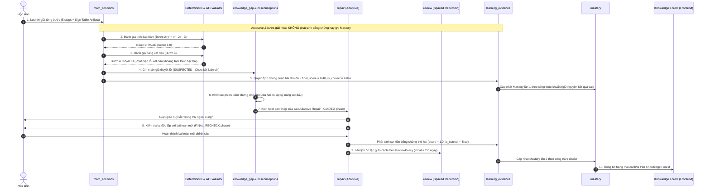

# Thiết kế Lát cắt Dọc (Vertical Slice End-to-End Design)
## Kịch bản: Học sinh giải bài Tính Đơn Điệu, Tính Đạo Hàm Đúng nhưng Sai Bảng Xét Dấu

> **Bắt buộc trước migration — STEP-ARCH-00:** [Final Schema & Effective Evidence Safety Gate](STEP_ARCH_00_SAFETY_GATE.md) là quyết định thiết kế ưu tiên nếu các ví dụ SQL/logic bên dưới còn mâu thuẫn. Chưa xác minh PostgreSQL runtime.

- **Dự án**: Coach Learning (EduMS)
- **Mã tài liệu**: SLICE-M12-01
- **Mã Sprint**: SPRINT-01.1
- **Phạm vi học thuật**: `MONOTONICITY_FROM_EXPRESSION` (Toán 12 GDPT 2018)
- **Trạng thái**: ĐẶC TẢ LÁT CẮT DỌC ĐÃ HIỆU CHỈNH (CORRECTED SPECIFICATION)

---

## 1. Bối cảnh Kịch bản & Phân rã Sai sót Sư phạm

### 1.1. Bài toán Mẫu
$$\text{Tìm các khoảng đồng biến và nghịch biến của hàm số: } y = f(x) = \frac{1}{3}x^3 - x^2 - 3x + 1$$

### 1.2. Diễn biến Tư duy của Học sinh
- **Bước 1 (Tập xác định)**: $D = \mathbb{R}$. (Chính xác).
- **Bước 2 (Tính đạo hàm)**: $y' = x^2 - 2x - 3$. (Chính xác).
- **Bước 3 (Tìm nghiệm đạo hàm)**: $y' = 0 \Leftrightarrow x = -1 \text{ hoặc } x = 3$. (Chính xác).
- **Bước 4 (Lập bảng xét dấu đạo hàm)**:
  - Học sinh vẽ bảng xét dấu cho tam thức bậc hai $x^2 - 2x - 3$ có hai nghiệm $x_1 = -1, x_2 = 3$ và hệ số $a = 1 > 0$.
  - **Sai sót phát sinh**: Học sinh áp dụng sai quy tắc dấu tam thức bậc hai ("trong trái ngoài cùng" bị đảo ngược thành "trong cùng ngoài khác"):
    - Khoảng $(-1, 3)$: điền dấu $+$ (Sai).
    - Khoảng $(-\infty, -1)$ và $(3, +\infty)$: điền dấu $-$ (Sai).
- **Bước 5 (Kết luận chiều biến thiên)**:
  - Học sinh suy luận: $y' > 0$ trên $(-1, 3) \implies$ đồng biến trên $(-1, 3)$; $y' < 0$ trên các khoảng ngoài $\implies$ nghịch biến trên $(-\infty, -1)$ và $(3, +\infty)$.
  - **Lưu ý sư phạm then chốt**: Bước 5 sai về kết quả nhưng **quy tắc suy luận chiều biến thiên từ dấu đạo hàm của học sinh là hoàn toàn đúng** (học sinh hiểu $y' > 0 \implies$ đồng biến, $y' < 0 \implies$ nghịch biến). Lỗi gốc nằm hoàn toàn ở Bước 4 (xét dấu tam thức bậc hai).

---

### 1.3. Phân biệt Rạch ròi 4 Lớp Sai sót (Taxonomy Disentanglement)

Để tránh nhầm lẫn nghiêm trọng trong việc phân loại quan niệm sai lầm, hệ thống phân định rõ 4 lớp lỗi độc lập:

| Lớp lỗi | Mã nhận diện | Bản chất toán học | Ví dụ biểu hiện |
| :--- | :--- | :--- | :--- |
| **(a) Lỗi tính toán đạo hàm** | `DERIVATIVE_ARITHMETIC_SLIP` | Áp dụng sai quy tắc đạo hàm (ví dụ $(x^3)' = 2x^2$) hoặc tính nhầm dấu đại số khi rút gọn. | $y' = x^2 + 2x - 3$ thay vì $x^2 - 2x - 3$. |
| **(b) Lỗi tìm nghiệm** | `ROOT_FINDING_ERROR` | Giải sai phương trình $y' = 0$ (tính nhầm $\Delta$ hoặc nhầm dấu nghiệm). | $x = 1 \lor x = -3$ thay vì $x = -1 \lor x = 3$. |
| **(c) Lỗi xét dấu khoảng của đạo hàm** | `SIGN_TABLE_QUADRATIC_RULE_INVERTED` *(Candidate, cần domain review)* | Đã có nghiệm đúng nhưng áp dụng sai quy tắc xét dấu tam thức bậc hai / nhầm dấu hệ số $a$. | $a = 1 > 0$ nhưng trong khoảng $(-1, 3)$ lại cho mang dấu $+$. |
| **(d) Lỗi suy luận chiều từ dấu đạo hàm** | `DERIVATIVE_SIGN_DIRECTION` *(Canonical Seed)* | Đã biết dấu của $y'$ nhưng đảo ngược quan hệ đơn điệu ($y' < 0$ lại bảo đồng biến, $y' > 0$ lại bảo nghịch biến). | Thấy $y' > 0$ trên $(3, +\infty)$ nhưng lại kết luận hàm nghịch biến trên $(3, +\infty)$. |

> [!IMPORTANT]
> **Hiệu chỉnh Sprint 1.1**: Bước 4 của học sinh trong kịch bản này là **Lớp (c) — Lỗi xét dấu khoảng**, KHÔNG PHẢI **Lớp (d) — `DERIVATIVE_SIGN_DIRECTION`**.
> Hệ thống gắn cờ giả thuyết sơ bộ là `SIGN_TABLE_QUADRATIC_RULE_INVERTED` (Candidate Misconception đang trong diện thẩm định học thuật). Trạng thái ghi nhận là `SUSPECTED`, tuyệt đối không xác nhận `CONFIRMED` khi chưa có bài kiểm chứng độc lập.

---

## 2. Luồng Xử lý 10 Giai đoạn Chuẩn xác (10-Stage Lifecycle)

---

## 3. Đặc tả Chi tiết Từng Giai đoạn

### Giai đoạn 1: Lưu Lời giải Từng bước (Save Step-by-Step Solution)
- **Module**: `backend/app/math_solutions/`
- **Thực thể dữ liệu**:
  - `math_solution_attempts`: `status = 'IN_PROGRESS'`, `mode = 'GUIDED_LEARNING'`, `attempt_revision_number = 1`, `idempotency_key = "client-uuid-001"`.
  - `math_solution_steps`: 5 bản ghi bước giải với `step_index` từ 1 đến 5.
  - `math_step_revisions`: 5 bản ghi revision tương ứng (`step_revision_number = 1`, `change_reason = 'STUDENT_EDIT'`).
  - `math_artifacts`: Gắn chặt với `math_step_revisions` của Bước 4 (chứa payload JSON của bảng xét dấu).
- **Ràng buộc an toàn**: Hoàn toàn **không phát sinh sự kiện `LearningEvidenceEvent`**; bảng `student_problem_type_mastery` không bị biến động.

---

### Giai đoạn 2: Kiểm chứng Bước Tính Đạo hàm Đúng (Derivative Step Verified)
- **Module**: `math_solutions/` phối hợp bộ kiểm chứng toán học `DeterministicMathValidator`.
- **Xử lý**:
  - Phép tính vi phân hình thức: $\frac{d}{dx}\left(\frac{1}{3}x^3 - x^2 - 3x + 1\right) = x^2 - 2x - 3$.
  - Biểu thức tại `math_step_revisions` của Bước 2 trùng khớp 100% với đạo hàm giải tích.
- **Dữ liệu tạo lập**:
  - `math_step_evaluations`:
    - `step_revision_id`: Trỏ tới revision của Bước 2.
    - `evaluator_type = 'DETERMINISTIC_RULES'`.
    - `is_valid_math = 'VALID'`.
    - `score = 1.0`, `confidence = 1.0`, `error_detected = False`.

---

### Giai đoạn 3: Nhận diện Lỗi Xét dấu Khoảng theo Rubric
- **Module**: `math_solutions/` (phối hợp `SolutionRubricMatcher`).
- **Xử lý**:
  - Đối chiếu `MathArtifact` của Bước 4 với tiêu chí của `SolutionRubric`:
    - Biểu thức $y' = x^2 - 2x - 3$ có $a = 1 > 0$ và 2 nghiệm phân biệt $-1$ và $3$.
    - Quy tắc chuẩn: Khoảng giữa hai nghiệm $(-1, 3)$ phải mang dấu $-$ (trái dấu với $a$); hai khoảng ngoài mang dấu $+$ (cùng dấu với $a$).
    - Dữ liệu học sinh nhập: $(-1, 3)$ mang dấu $+$; ngoài mang dấu $-$.
- **Dữ liệu tạo lập**:
  - `math_step_evaluations`:
    - `step_revision_id`: Trỏ tới revision của Bước 4.
    - `evaluator_type = 'DETERMINISTIC_RULES'`.
    - `is_valid_math = 'INVALID'`.
    - `score = 0.0`, `confidence = 1.0`, `error_detected = True`.
    - `misconception_definition_id`: Tham chiếu mã ứng viên `SIGN_TABLE_QUADRATIC_RULE_INVERTED` *(đang review)*.
    - `error_description = "Đảo ngược dấu tam thức bậc hai trên các khoảng nghiệm (trong cùng ngoài khác)."`.

---

### Giai đoạn 4: Ghi nhận Giả thuyết Sơ bộ (Hypothesis Formation - SUSPECTED)
- **Module**: `backend/app/knowledge_gap/` & `backend/app/misconceptions/`.
- **Nguyên tắc sư phạm**: Hệ thống ghi nhận đây là một **giả thuyết (HYPOTHESIS)** cần kiểm chứng, tuyệt đối **không tự động đánh dấu `CONFIRMED`** chỉ sau 1 bước giải sai.
- **Dữ liệu tạo lập / Cập nhật**:
  - `student_misconceptions`: `status = 'SUSPECTED'`, `occurrence_count = 1`, `confidence = 0.60`.
  - `root_cause_diagnoses`: `diagnosis_type = 'MISCONCEPTION_HYPOTHESIS'`, `status = 'HYPOTHESIS'`.

---

### Giai đoạn 5: Ban hành Quyết định Lần 1 & Giữ nguyên Kết quả Sai
- **Module**: `math_solutions/` $\to$ `learning_evidence/` $\to$ `mastery/`.
- **Nguyên tắc bất biến**: **Bài giải ban đầu sai phải giữ nguyên kết quả sai**; không được tự động "sửa điểm" của bài thi đầu tiên.
- **Dữ liệu tạo lập**:
  - `math_evaluation_decisions`:
    - `attempt_id`: Trỏ tới bài làm đầu.
    - `final_score = 0.40` (điểm thành phần: đúng TXĐ, tính đúng đạo hàm và nghiệm, sai bảng xét dấu và kết luận).
    - `is_correct = False`.
    - `decision_source = 'AUTOMATED_CONSENSUS'`.
  - `learning_evidence_events`: Phát sinh **duy nhất 1 sự kiện append-only**:
    - `source_kind = 'MATH_SOLUTION_EVALUATION'`.
    - `source_entity_id = evaluation_decision.id`.
    - `score = 0.40`, `is_correct = False`, `difficulty = 0.50`, `hint_count = 0`.
- **Cập nhật Mastery lần 1** (sử dụng công thức `DeterministicMasteryCalculationStrategy`):
  - Giả sử trạng thái trước đó: `mastery_score = 0.0`, `confidence = 0.0`, `attempt_count = 0`.
  - $\text{difficulty\_factor} = 1.1 - 0.3 \times 0.50 = 0.95$.
  - $\text{mastery\_rate} = \min(0.3, 0.22 \times 1.0 \times 0.95 \times 1.0) = 0.209$.
  - $\text{mastery\_score} = 0.0 + 0.209 \times (0.40 - 0.0) = \mathbf{0.0836}$.
  - $\text{confidence\_gain} = 0.13 \times 1.0 \times 1.0 \times (0.9 + 0.1 \times 0.50) = 0.1235$.
  - $\text{confidence} = 0.0 + 0.1235 \times (1.0 - 0.0) = \mathbf{0.1235}$.
  - `attempt_count = 1`, `correct_count = 0`.
  - **Trạng thái theo `derive_mastery_state`**: $\mathbf{LEARNING}$ (vì `attempt_count == 1` và chưa đủ điều kiện `WEAK` do `confidence < 0.25`).

---

### Giai đoạn 6: Kiểm chứng Độc lập (Independent Verification)
- **Module**: `knowledge_gap/verification.py` & `questions/`.
- **Thực thi**:
  - Giao câu hỏi kiểm chứng cô lập: *"Cho biểu thức $P(x) = (x-2)(x+1)$. Trên khoảng $(-1, 2)$, $P(x)$ mang dấu gì?"*.
  - Học sinh làm bài: Nếu tiếp tục trả lời dấu $+$, hệ thống xác nhận chẩn đoán nguyên nhân gốc rễ là học sinh chưa nắm quy tắc dấu tam thức bậc hai.
  - `root_cause_verifications`: ghi nhận kết quả kiểm chứng.

---

### Giai đoạn 7: Can thiệp Sửa sai Có Giàn giáo (Adaptive Repair - GUIDED)
- **Module**: `backend/app/repair/`.
- **Thực thi**:
  - Khởi tạo `AdaptiveRepairSession` (áp dụng `AdaptiveRepairPolicy` với `initial_phase = FOUNDATION` hoặc `TARGET_PRACTICE`).
  - Pha `GUIDED`: Hệ thống cung cấp câu hỏi luyện tập có giàn giáo:
    - Nhắc quy tắc: "Trong khoảng 2 nghiệm trái dấu hệ số $a$; ngoài khoảng 2 nghiệm cùng dấu hệ số $a$".
    - Cho học sinh điền bảng xét dấu tương tác.

---

### Giai đoạn 8: Kiểm tra Lại Độc lập (Final Recheck - Independent Event)
- **Module**: `backend/app/repair/` (pha `FINAL_RECHECK`).
- **Thực thi**:
  - Hệ thống giao một **bài toán mới độc lập**: $y = -x^3 + 3x^2 - 2$.
  - Học sinh giải độc lập hoàn toàn (`mode = 'INDEPENDENT_SOLUTION'`), tính đúng đạo hàm $y' = -3x^2 + 6x$, tìm đúng nghiệm $x = 0, x = 2$, lập đúng bảng xét dấu (với $a = -3 < 0$, trong mang dấu $+$, ngoài mang dấu $-$) và kết luận chính xác.
  - `AdaptiveRepairSession`: `outcome = 'RESOLVED'`, `status = 'COMPLETED'`.
  - `student_misconceptions`: Chuyển từ `SUSPECTED` sang `RESOLVED`.
- **Phát sinh Bằng chứng Độc lập Lần 2**:
  - Bản ghi `math_solution_attempts` mới được chấm: `final_score = 1.0`, `is_correct = True`.
  - Phát sinh `LearningEvidenceEvent` độc lập thứ 2: `score = 1.0`, `is_correct = True`, `difficulty = 0.50`, `hint_count = 0`.
- **Cập nhật Mastery lần 2**:
  - $\text{difficulty\_factor} = 0.8 + 0.4 \times 0.50 = 1.0$.
  - $\text{mastery\_rate} = \min(0.3, 0.22 \times 1.0 \times 1.0 \times 1.0) = 0.22$.
  - $\text{mastery\_score} = 0.0836 + 0.22 \times (1.0 - 0.0836) = \mathbf{0.2852}$.
  - $\text{confidence} = 0.1235 + 0.1235 \times (1.0 - 0.1235) = \mathbf{0.2317}$.
  - `attempt_count = 2`, `correct_count = 1`.
  - **Trạng thái**: Tiếp tục ở `LEARNING` và dần tiến tới `PRACTICING` qua các phiên luyện tập tiếp theo.

---

### Giai đoạn 9: Lên Lịch Ôn tập Giãn cách Chuẩn theo `ReviewPolicy`
- **Module**: `backend/app/review/` & `backend/app/learning/feedback_policy.py`.
- **Xác định Chu kỳ Ôn tập Chuẩn xác**:
  - Theo `LearningFeedbackPolicy.resolved_review_interval_days`: Giá trị mặc định khi vừa hoàn thành phiên repair thành công là **2.0 ngày**.
  - Theo `ReviewPolicy` (`backend/app/review/policy.py`):
    - `ReviewThresholds`: `initial_interval_days = 1.0`, `growth_factor = 2.0`.
    - Sau một kết quả `ReviewResult.GOOD`: $\text{next\_interval} = 1.0 \times 2.0 = \mathbf{2.0\text{ ngày}}$ (hoàn toàn không phải con số cảm tính "+3 ngày").
- **Dữ liệu tạo lập**:
  - `review_schedules`: `next_review_at = NOW() + INTERVAL '2 days'`, `review_count = 1`.

---

### Giai đoạn 10: Phản ánh Trực quan lên Knowledge Forest (Frontend)
- **Module**: `frontend/src/features/knowledge-forest/`.
- **Hiển thị thực tế**:
  - Trạng thái Mastery đồng bộ về client: `mastery_score \approx 0.29`, `attempt_count = 2`, trạng thái `LEARNING`.
  - Chiếc lá `MONOTONICITY_FROM_EXPRESSION` trên cành Chương 1 hiển thị viền trạng thái đang học (`leaf_LEARNING`).
  - Drawer hiển thị rõ: "Lịch ôn tập tiếp theo: sau 2 ngày".
  - **Không hiển thị trái quả**: Vì quả chỉ nở khi đạt trạng thái `MASTERED` (`mastery_score >= 0.8` và `confidence >= 0.65`).

---

## 4. Architecture Decision Record (ADR)

### ADR-04: Chuẩn hóa Lát cắt Dọc Toán 12 và Phân loại Sai sót Sư phạm

- **Trạng thái**: ĐÃ DUYỆT (ACCEPTED)
- **Quyết định**:
  1. Tách biệt hoàn toàn lỗi xét dấu khoảng tam thức bậc hai khỏi `DERIVATIVE_SIGN_DIRECTION`. Gắn mã ứng viên `SIGN_TABLE_QUADRATIC_RULE_INVERTED` dưới dạng `SUSPECTED`.
  2. Bảo toàn kết quả sai của bài làm ban đầu: emit `LearningEvidenceEvent` với điểm thực tế ($0.40$), không ghi đè thành công giả tạo.
  3. Xử lý các pha Kiểm chứng, Sửa sai và Ôn tập như các phiên độc lập, mỗi phiên phát sinh bằng chứng riêng biệt.
  4. Chuẩn hóa chu kỳ ôn tập ngắt quãng thành 2.0 ngày theo đúng `ReviewPolicy` và `LearningFeedbackPolicy` của backend.
  5. Loại bỏ toàn bộ các số liệu Mastery bịa đặt, tính toán nhất quán theo `DeterministicMasteryCalculationStrategy`.

---
### Teacher regrade không tạo lần học mới
Nếu giáo viên sửa điểm bài đầu từ 0.40 sang 1.0, lưu override audit và rebuild effective Mastery; không thêm `LearningEvidenceEvent`. Hai sự kiện trong vertical slice đại diện cho **hai lượt giải thực** (bài đầu và independent recheck), không phải điểm cũ + correction.
