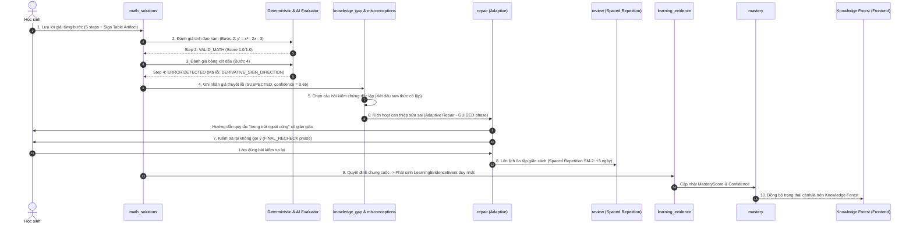

# Thiết kế Lát cắt Dọc (Vertical Slice End-to-End Design)
## Kịch bản: Học sinh giải bài Tính Đơn Điệu, Tính Đạo Hàm Đúng nhưng Sai Bảng Xét Dấu

- **Dự án**: Coach Learning (EduMS)
- **Mã tài liệu**: SLICE-M12-01
- **Phạm vi dạng bài**: `MONOTONICITY_FROM_EXPRESSION` (Toán 12)
- **Mục tiêu**: Mô tả tường minh 10 giai đoạn tương tác và xử lý dữ liệu giữa các module khi học sinh gặp lỗi xét dấu đạo hàm.

---

## 1. Bối cảnh Kịch bản (Scenario Context)

- **Học sinh**: Nguyễn Văn An (`student_id = "006bbc79-..."`), trình độ đang học lớp 12.
- **Bài toán mẫu**:
  $$\text{Tìm các khoảng đồng biến và nghịch biến của hàm số: } y = \frac{1}{3}x^3 - x^2 - 3x + 1$$
- **Diễn biến tư duy của học sinh**:
  - Học sinh nắm vững công thức đạo hàm hàm đa thức: tính chính xác $y' = x^2 - 2x - 3$.
  - Học sinh giải chính xác phương trình $y' = 0 \Leftrightarrow x = -1 \text{ hoặc } x = 3$.
  - **Lỗi phát sinh**: Khi lập bảng xét dấu cho tam thức bậc hai $x^2 - 2x - 3$, học sinh nhớ nhầm quy tắc "trong trái ngoài cùng" thành "trong cùng ngoài khác" (hoặc nhầm dấu hệ số $a=1 > 0$), dẫn đến bảng xét dấu:
    - Khoảng $(-1, 3)$: điền dấu $+$ (Sai).
    - Khoảng $(-\infty, -1)$ và $(3, +\infty)$: điền dấu $-$ (Sai).
  - Học sinh kết luận hàm số đồng biến trên $(-1, 3)$ và nghịch biến trên $(-\infty, -1) \cup (3, +\infty)$ (Sai do hệ quả từ bảng xét dấu).

---

## 2. Luồng Xử lý 10 Giai đoạn của Hệ thống (10-Stage Lifecycle)



---

## 3. Đặc tả Chi tiết Từng Giai đoạn

### Giai đoạn 1: Lưu Lời giải Từng bước (Save Step-by-Step Solution)
- **Module chịu trách nhiệm**: `backend/app/math_solutions/`
- **Dữ liệu tạo lập**:
  - `math_solution_attempts`: Tạo bản ghi mới với `status = 'IN_PROGRESS'`, `mode = 'GUIDED_LEARNING'`.
  - `math_solution_steps`: Tạo 5 bước:
    - *Bước 1* (`step_type = 'ASSUMPTION'`): $D = \mathbb{R}$.
    - *Bước 2* (`step_type = 'DERIVATIVE_CALCULATION'`): $y' = x^2 - 2x - 3$.
    - *Bước 3* (`step_type = 'ROOT_FINDING'`): $y' = 0 \Leftrightarrow x = -1 \lor x = 3$.
    - *Bước 4* (`step_type = 'SIGN_TABLE'`): Gắn kèm `MathArtifact`.
    - *Bước 5* (`step_type = 'CONCLUSION'`): "Hàm số đồng biến trên $(-1, 3)$...".
  - `math_artifacts`: Lưu cấu trúc bảng xét dấu của Bước 4:
    ```json
    {
      "variable": "x",
      "row_expression": "y'",
      "intervals": [
        { "label": "-inf", "value": null },
        { "label": "-1", "value": -1, "sign_at": "0" },
        { "label": "3", "value": 3, "sign_at": "0" },
        { "label": "+inf", "value": null }
      ],
      "signs": [
        { "from": "-inf", "to": "-1", "sign": "-" },
        { "from": "-1", "to": "3", "sign": "+" },
        { "from": "3", "to": "+inf", "sign": "-" }
      ]
    }
    ```
  - `math_step_revisions`: Tạo 5 bản ghi revision tương ứng (`revision_number = 1`, `change_reason = 'STUDENT_EDIT'`).
- **An toàn Mastery**: Chưa phát sinh bất kỳ bằng chứng `LearningEvidenceEvent` nào.

---

### Giai đoạn 2: Xác định Bước Tính Đạo hàm Đúng (Derivative Step Verified)
- **Module chịu trách nhiệm**: `math_solutions/` (phối hợp bộ kiểm chứng toán học `DeterministicMathValidator`).
- **Xử lý**:
  - Đối chiếu biểu thức của hàm số $f(x) = \frac{1}{3}x^3 - x^2 - 3x + 1$ với $y'$ học sinh nhập.
  - Phép tính vi phân hình thức: $\frac{d}{dx}f(x) = x^2 - 2x - 3$.
  - Biểu thức của học sinh: $x^2 - 2x - 3 \equiv \frac{d}{dx}f(x)$.
- **Dữ liệu tạo lập**:
  - `math_step_evaluations` cho Bước 2:
    - `is_valid_math = True`
    - `score = 1.0`
    - `confidence = 1.0`
    - `error_detected = False`
    - `evaluator_type = 'DETERMINISTIC_RULES'`
- **Ý nghĩa sư phạm**: Hệ thống khẳng định học sinh đã làm chủ kỹ năng tính đạo hàm đa thức, không bị nhầm lẫn ở bước giải tích cơ bản.

---

### Giai đoạn 3: Nhận diện Lỗi Xét Dấu có Căn cứ (Evidence-based Sign Error Detection)
- **Module chịu trách nhiệm**: `math_solutions/` (phối hợp `SolutionRubricMatcher`).
- **Xử lý**:
  - Đối chiếu `MathArtifact` của Bước 4 với `criteria` của `SolutionRubric`:
    - Tiêu chí chuẩn: Với tam thức bậc hai $y' = x^2 - 2x - 3$ có $a = 1 > 0$ và hai nghiệm phân biệt $x_1 = -1 < x_2 = 3$:
      - Trong khoảng hai nghiệm $(-1, 3)$: $y'$ mang dấu trái dấu với $a$ $\to$ Dấu âm ($-$).
      - Ngoài khoảng hai nghiệm: $y'$ mang dấu cùng dấu với $a$ $\to$ Dấu dương ($+$).
    - Dữ liệu thực tế học sinh nộp: Ngược hoàn toàn (trong $+$, ngoài $-$).
  - Đối chiếu với taxonomy lỗi: Khớp chính xác với định nghĩa quan niệm sai lầm `DERIVATIVE_SIGN_DIRECTION`.
- **Dữ liệu tạo lập**:
  - `math_step_evaluations` cho Bước 4:
    - `is_valid_math = False`
    - `score = 0.0`
    - `error_detected = True`
    - `misconception_definition_id` $\to$ FK của mã `DERIVATIVE_SIGN_DIRECTION`.
    - `error_description = "Học sinh đảo ngược dấu của tam thức bậc hai trên các khoảng nghiệm."`
    - `evidence_quote = "signs: [(-inf, -1): -, (-1, 3): +, (3, +inf): -]"`

---

### Giai đoạn 4: Đưa ra Giả thuyết, Không Kết luận Vội (Hypothesis Formation)
- **Module chịu trách nhiệm**: `backend/app/knowledge_gap/` & `backend/app/misconceptions/`.
- **Nguyên tắc sư phạm**: Một sai sót đơn lẻ có thể là do đãng trí (slip) hoặc do lỗ hổng kiến thức thực sự (deep misconception). Hệ thống **không được** vội vàng gắn nhãn học sinh "học yếu" hay xác nhận `CONFIRMED`.
- **Dữ liệu tạo lập / Cập nhật**:
  - `student_misconceptions`:
    - `status = 'SUSPECTED'` (Chưa phải `CONFIRMED`).
    - `confidence = 0.65`.
    - `occurrence_count = 1`.
  - `root_cause_diagnoses`:
    - `diagnosis_type = 'MISCONCEPTION_HYPOTHESIS'`.
    - `status = 'HYPOTHESIS'`.
    - `target_problem_type_id = MONOTONICITY_FROM_EXPRESSION`.

---

### Giai đoạn 5: Chọn Câu hỏi Kiểm chứng Hợp lệ (Independent Verification Selection)
- **Module chịu trách nhiệm**: `knowledge_gap/verification.py` & `questions/`.
- **Tiêu chí chọn câu kiểm chứng**:
  - Câu hỏi phải **cô lập hoàn toàn kỹ năng xét dấu**, loại bỏ gánh nặng tính đạo hàm để kiểm tra đích xác nguyên nhân gốc rễ.
  - Ví dụ câu hỏi kiểm chứng:
    *"Cho hàm số $y=f(x)$ có đạo hàm $f'(x) = (x-2)(x+1)$. Hãy cho biết trên khoảng $(-1, 2)$, đạo hàm $f'(x)$ mang dấu gì?"*
- **Dữ liệu tạo lập**:
  - `root_cause_verifications`: Khởi tạo phiên kiểm chứng với câu hỏi được chọn.

---

### Giai đoạn 6: Hướng dẫn Sửa Đúng Kỹ năng Yếu (Targeted Adaptive Repair - GUIDED)
- **Module chịu trách nhiệm**: `backend/app/repair/`.
- **Xử lý**:
  - Kích hoạt `AdaptiveRepairSession` với mục tiêu: Củng cố quy tắc xét dấu tam thức bậc hai $ax^2 + bx + c$.
  - Pha `GUIDED`: Hệ thống cung cấp giàn giáo sư phạm:
    1. Nhắc lại trực quan quy tắc "Trong trái - Ngoài cùng": Hệ số $a > 0$ thì trong khoảng 2 nghiệm phải mang dấu âm (trái dấu $a$).
    2. Cho học sinh thực hành tương tác điền lại bảng xét dấu với gợi ý phân tầng (`QuestionHint`).

---

### Giai đoạn 7: Kiểm tra Lại Không có Gợi ý (Unassisted Final Recheck)
- **Module chịu trách nhiệm**: `backend/app/repair/` (pha `FINAL_RECHECK`).
- **Xử lý**:
  - Chuyển `AdaptiveRepairSession` sang pha `FINAL_RECHECK`.
  - Giao một bài toán mới hoàn toàn về Tính đơn điệu: $y = -x^3 + 3x^2 - 2$.
  - Yêu cầu học sinh giải độc lập (`mode = 'INDEPENDENT_SOLUTION'`), không cung cấp gợi ý hay feedback giữa chừng.
  - Học sinh hoàn thành chính xác cả bước tính đạo hàm, bước lập bảng xét dấu và kết luận.
- **Dữ liệu cập nhật**:
  - `AdaptiveRepairSession`: `outcome = 'RESOLVED'`, `status = 'COMPLETED'`.
  - `student_misconceptions`: Chuyển từ `SUSPECTED` sang `RESOLVED`.

---

### Giai đoạn 8: Lên Lịch Ôn tập Giãn cách (Spaced Review Scheduling)
- **Module chịu trách nhiệm**: `backend/app/review/`.
- **Xử lý**:
  - Kích hoạt thuật toán lặp lại ngắt quãng SM-2 (`review/policy.py`).
  - Ghi nhận `ReviewResult = 'GOOD'` cho dạng bài `MONOTONICITY_FROM_EXPRESSION`.
  - Tính toán khoảng cách ôn tập tiếp theo: `review_interval_days = 3`.
- **Dữ liệu tạo lập / Cập nhật**:
  - `review_schedules`:
    - `next_review_at = NOW() + INTERVAL '3 days'`.
    - `review_count = review_count + 1`.
  - Khi đến hạn 3 ngày sau, hệ thống sẽ tự động hiển thị lá tri thức ở trạng thái `REVIEW_DUE` trên Knowledge Forest.

---

### Giai đoạn 9: Cập nhật Mastery từ Bằng chứng Hợp lệ (Mastery Update via Single Evidence)
- **Module chịu trách nhiệm**: `math_solutions/` $\to$ `learning_evidence/` $\to$ `mastery/`.
- **Xử lý**:
  - `EvaluationDecision` được ban hành chính thức cho phiên làm bài:
    - `final_score = 1.0` (sau khi đã hoàn thành chu trình sửa sai và kiểm tra lại đạt chuẩn).
    - `is_correct = True`.
  - **Phát sinh duy nhất 1 sự kiện bất biến**:
    - `learning_evidence_events`: Ghi nhận `source_kind = 'PRACTICE_QUESTION'`, `source_entity_id = decision.id`, `score = 1.0`.
  - `MasteryService` lắng nghe sự kiện bằng chứng và cập nhật:
    - `StudentProblemTypeMastery` của `MONOTONICITY_FROM_EXPRESSION`:
      - `mastery_score`: tăng từ 0.0 lên 0.75.
      - `confidence`: tăng lên 0.72.
      - `attempt_count`: tăng 1.
      - `correct_count`: tăng 1.
      - `last_practiced_at = NOW()`.

---

### Giai đoạn 10: Đồng bộ Trạng thái lên Knowledge Forest (Knowledge Tree Synchronization)
- **Module chịu trách nhiệm**: `frontend/src/features/knowledge-forest/`.
- **Xử lý**:
  - Khi học sinh tải lại hoặc mở trang `/student/knowledge`:
    - API `GET /students/me/mastery` trả về `mastery_score = 0.75`, `confidence = 0.72` cho dạng bài `MONOTONICITY_FROM_EXPRESSION`.
    - Hàm chuyển đổi `deriveMasteryState` xác định trạng thái chuyển từ `NOT_STARTED` hoặc `WEAK` sang **`PRACTICING`**.
  - **Hiển thị trực quan trên cây Living Tree**:
    - Chiếc lá dạng bài tương ứng trên nhánh Chương 1 ("Applications of Derivatives" $\to$ "Monotonicity") đổi màu viền sang sắc xanh lá đang phát triển (`leaf_PRACTICING`).
    - Tooltip và Drawer hiển thị: "Độ vững: 75% · Đang luyện tập".
    - Không hiển thị trái quả (vì quy tắc: chỉ `MASTERED` với điểm $\ge 85\%$ và confidence $\ge 0.70$ mới có trái).

---

## 4. Tóm tắt Phân công Trách nhiệm Module & Thực thể

| Giai đoạn | Hành động nghiệp vụ | Module phụ trách | Thực thể dữ liệu thao tác |
| :---: | :--- | :--- | :--- |
| **1** | Lưu bài giải từng bước & bảng xét dấu | `math_solutions` | `math_solution_attempts`, `math_solution_steps`, `math_artifacts`, `math_step_revisions` |
| **2** | Kiểm chứng đạo hàm đúng | `math_solutions` (Validator) | `math_step_evaluations` |
| **3** | Phát hiện lỗi xét dấu theo rubric | `math_solutions` (Evaluator) | `math_step_evaluations`, `math_solution_rubrics` |
| **4** | Ghi nhận giả thuyết lỗi sơ bộ | `misconceptions`, `knowledge_gap` | `student_misconceptions` (`SUSPECTED`), `root_cause_diagnoses` |
| **5** | Chọn câu hỏi kiểm chứng độc lập | `knowledge_gap`, `questions` | `root_cause_verifications`, `questions` |
| **6** | Can thiệp sửa sai có giàn giáo | `repair` | `adaptive_repair_sessions` (pha `GUIDED`) |
| **7** | Kiểm tra lại không gợi ý | `repair` | `adaptive_repair_sessions` (pha `FINAL_RECHECK`) |
| **8** | Lên lịch ôn tập giãn cách SM-2 | `review` | `review_schedules` |
| **9** | Ban hành quyết định & cập nhật Mastery | `math_solutions`, `learning_evidence`, `mastery` | `math_evaluation_decisions`, `learning_evidence_events`, `student_problem_type_mastery` |
| **10** | Phản ánh trực quan lên Living Tree | `knowledge-forest` (Frontend) | `KnowledgeForestTree`, `KnowledgeDetailDrawer` |
