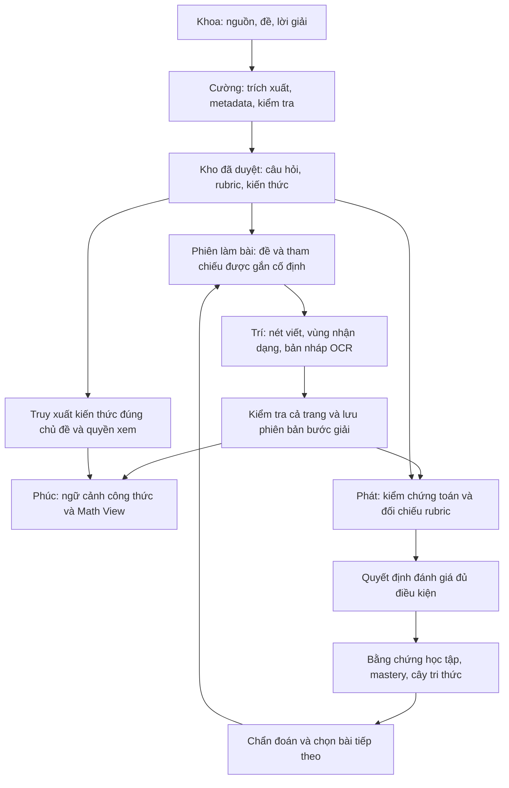

# Thiết kế ghép các phần việc của Coach_Learning

Ngày: 01/11/2026. Trạng thái: **đề xuất để cả nhóm chốt giao diện bàn giao**.

Nhóm hiện mới phân công, chưa ghép các phần theo xác nhận của người dùng. Các module dưới đây đã có nền tảng trong repo; sự tồn tại của source code không chứng minh luồng ghép mới đã chạy. Tài liệu này không thay đổi API, database hay hành vi chấm bài. Tên service và endpoint ghi “đề xuất” chưa được triển khai.

## 1. Quyết định kiến trúc

Giữ frontend Next.js và backend FastAPI hiện tại. Mỗi phần việc là một module trong cùng hệ thống, dùng chung người dùng, database và mã định danh học thuật. Giao tiếp qua các service/adapter và hợp đồng dữ liệu có phiên bản; chưa cần tách thành nhiều backend hoặc thêm message broker cho luồng đầu tiên.

Điểm nối trung tâm là **ngữ cảnh của một phiên làm bài và một phiên bản bước giải**. Một chuỗi LaTeX riêng lẻ không cho biết nó thuộc đề nào, do học sinh viết hay lấy từ đáp án, được đọc từ phiên bản nét bút nào, và được phép dùng để chấm hay chỉ để xem.



Hai nhánh cần hoạt động độc lập: học sinh có thể xem đồ thị trước khi nộp; chỉ quyết định đánh giá đủ điều kiện mới được tác động vào mastery. Kéo hệ số, mở hình, nhận dạng chữ hoặc đọc gợi ý không phải bằng chứng làm đúng bài.

## 2. Những phần có sẵn và khoảng trống

| Mảng | Nền tảng đã đọc trong repo | Cần nối thêm |
| --- | --- | --- |
| Nguồn và câu hỏi | `backend/data/provenance/sources.json`; Question/importer có nguồn, đáp án, lời giải, concept, problem type | Gói bàn giao thống nhất từ nhóm data; kiểm tra nguồn/duyệt trước khi xuất bản |
| Tri thức tham khảo | `app/rag`: Document, DocumentChunk, metadata học thuật, tìm kiếm | Liên kết kiến thức với đúng bước/dạng bài; giữ tham chiếu nguồn và phân loại quyền xem |
| Nét viết và OCR | `app/math_ink`; `app/math_ocr`; frontend có bản nháp OCR, phân loại bước và batch manager | Gắn nguồn nét viết với phiên bản bước giải bền vững; quy trình duyệt cả trang |
| Bước giải | SolutionAttempt, SolutionStep, StepRevision, MathArtifact | Adapter dùng cùng ngữ cảnh cho OCR, chấm bài và Math View |
| Chấm bài | `grading_context.py`, `evaluator_service.py`, rubric, answer-grounded AI review | Luồng điều phối rõ cho từng chế độ học; danh mục dạng bài đủ điều kiện chấm |
| Cây tri thức | LearningEvidencePublisher, MathSolutionEvidenceAdapter, StudentLearningStateService | Làm mới giao diện sau quyết định đánh giá; hiển thị lý do và mức chắc chắn |
| Trực quan hóa | MathCanvasPanel, GraphScenePanel, MathLab; snapshot đã lưu công thức, camera, nét viết | MathViewContext và liên kết snapshot với đúng step revision/nguồn tri thức |

Các giới hạn phải giữ khi ghép:

- Bộ chấm xác định hiện kiểm tra phạm vi đa thức đã hỗ trợ và rubric được duyệt; không suy ra khả năng chấm mọi dạng Toán từ khả năng vẽ của Math View.
- AI review hiện trả `is_final=false`, không ghi điểm chính thức, LearningEvidence hay mastery.
- Chấm xác định đã có đường gọi trong service nộp bài tập lớp. Chưa coi việc có `evaluate_attempt()` là bằng chứng mọi luồng tự luyện trên UI đều gọi được nó.
- RAG hiện cho phép lọc theo metadata, nhưng ngữ cảnh tutor đang chỉ truyền bộ lọc môn học. Việc lọc sâu theo concept/dạng bài là phần cần nối.
- Snapshot Math View hiện lưu `attempt_id`, công thức, settings/camera, nét viết và phiên bản ink; chưa có khóa ngoại `step_revision_id`.

## 3. Một bộ mã định danh cho cả nhóm

| Khóa | Ý nghĩa | Ai tạo/quản lý |
| --- | --- | --- |
| `source_id` / `source_code` | Nguồn gốc, bản tài liệu, trang/vị trí trích xuất | Gói nguồn của Khoa; importer ánh xạ khi nhập |
| `concept_code`, `problem_type_code` | Khóa bàn giao dữ liệu trước khi có UUID database | Khoa + Cường thống nhất với Phát |
| `concept_id`, `problem_type_id` | Tham chiếu đến cây tri thức đã có trong database | Backend/importer |
| `question_id` hoặc `assignment_material_item_id` | Đề thật của phiên làm bài | Backend; giữ hai loại nguồn hiện có |
| `attempt_id`, `attempt_revision` | Phiên và phiên bản bài làm | MathSolutionService |
| `page_index`, `ink_revision`, `page_sha256`, `stroke_ids` | Đúng trang và nét bút đã nhận dạng | Ink service + adapter OCR |
| `step_id`, `step_revision_id` | Một phiên bản nội dung bước giải cụ thể | MathSolutionService |
| `rubric_id`, `rubric_version` | Tiêu chí dùng cho lần đánh giá | Backend + người duyệt học thuật |
| `snapshot_id` | Bản lưu một lượt khám phá toán học | Math Canvas service |

Không dùng tên hiển thị như “Đạo hàm” để nối dữ liệu. Không tạo riêng một cây tri thức cho OCR, một cây cho chấm và một cây cho Math View. Trạng thái của từng học sinh nằm ở bảng mastery/evidence, không nằm trong bản sao cấu trúc cây.

Trong hợp đồng đề xuất, `attempt_revision` ánh xạ sang `current_revision` của response và `expected_attempt_revision` của request API hiện tại. Đừng đưa nguyên envelope đề xuất vào endpoint v2.

## 4. Khoa → Cường: gói dữ liệu có thể kiểm tra

Gói bàn giao đề xuất gồm:

```text
bundle/
  manifest.json
  sources.csv
  questions.jsonl
  knowledge_cards.jsonl
  reference_solutions.jsonl
  rubrics.jsonl
  assets/
  validation-report.json
```

`sources.csv` cần mã nguồn, tiêu đề, URL hoặc mô tả xuất xứ nội bộ, phiên bản tài liệu, trang/mục, thời điểm thu thập, tình trạng quyền sử dụng và checksum của tài liệu nếu đã có file. Nguồn nội bộ/AI hỗ trợ phải được ghi đúng xuất xứ; không gán URL bên ngoài cho nội dung nhóm tự soạn.

Tách ba đầu ra có nhiệm vụ khác nhau:

1. **Question**: đề, đáp án và lời giải tham chiếu; dùng định dạng của importer hiện có.
2. **KnowledgeCard**: khái niệm, điều kiện áp dụng, ví dụ, lỗi thường gặp, concept/problem type và tham chiếu nguồn; dùng cho tìm kiếm và giải thích.
3. **Rubric + reference steps**: tiêu chí có trọng số, dạng bước, quy tắc kiểm tra và phương án giải thay thế; dùng cho chấm trong phạm vi được hỗ trợ.

Có lời giải bằng văn bản chưa có nghĩa là đã có rubric máy chấm được. Một bài có thể đã được duyệt để đọc/luyện nhưng vẫn cần giáo viên đánh giá tự luận.

Luồng nhập: trích xuất → chuẩn hóa → đối chiếu nguồn → ánh xạ concept/dạng bài → kiểm tra trùng và nội dung toán → duyệt → công bố. Đây là trạng thái pipeline đề xuất; phải ánh xạ sang enum Question/Document thực tế, không thêm tùy tiện vào API.

Đặt rõ `DRAFT` khi tạo Document và Question trong pipeline. DocumentCreate hiện mặc định `PUBLISHED`; adapter nhập mới phải tránh vô tình xuất bản nội dung vừa OCR.

Điều kiện bàn giao: từng bản ghi truy được nguồn và vị trí; công thức không mất ký hiệu; concept code tồn tại hoặc được đưa vào danh sách chờ ánh xạ; rubric có tổng trọng số hợp lệ; nguồn chưa duyệt không vào kho học sinh.

## 5. Trí → Phát/Phúc: bản nháp nhận dạng và bước giải

### 5.1 Bản nháp OCR

Định dạng `OcrPageDraftV1` đề xuất chứa `attempt_id`, phiên bản bài, `page_index`, `ink_revision`, checksum trang, các region và các bước logic gợi ý. Region dùng bbox chuẩn hóa `(x,y,width,height)` trong [0,1], gốc trên trái. Điều kiện `x+width<=1`, `y+height<=1` phải được kiểm tra.

Một bước có thể ghép từ nhiều region; một region có thể cần tách thành nhiều bước. Giữ `source_region_ids` và `source_stroke_ids`, không ép một ô detection tương đương một bước logic.

Mỗi bước nháp giữ riêng `raw_ocr_latex`, `edited_latex`, loại bước gợi ý và trạng thái kiểm tra. `recognition_confidence` có thể null: CoMER trong browser không cung cấp confidence đã hiệu chuẩn. Không chuyển null thành 1 hoặc dùng confidence OCR làm điểm toán.

### 5.2 Giảm thao tác xác nhận

Với mong muốn trong ảnh là giảm xác nhận từng bước, đề xuất giao diện **kiểm tra cả trang một lần**:

1. Trí vẽ ô vùng nhận dạng trên giấy và hiển thị danh sách bước bên cạnh.
2. Học sinh sửa lỗi rõ ràng, ghép/tách vùng nếu cần; nội dung sửa tay không bị OCR ghi đè.
3. Một nút “Dùng các bước trên trang” lưu các bước đủ điều kiện. Các mục chưa có nội dung hoặc chưa xác định được loại bước vẫn được đánh dấu để xử lý.
4. Dùng batch manager hiện có để chống lưu trùng và tiếp tục khi mất mạng. Hiện đây là nhiều request có journal, không được mô tả là một transaction nguyên tử cho cả trang.

Đây là đề xuất UX, chưa phải thay đổi quy trình hiện tại. Nếu muốn bỏ toàn bộ thao tác kiểm tra OCR, cần đánh giá riêng; không tự nâng nội dung chưa kiểm tra thành dữ liệu chấm chính thức.

### 5.3 Bước đã lưu

Backend tạo `SolutionStep` và `StepRevision` bằng các API v2 hiện có. Liên kết nguồn OCR của revision là phần cần bổ sung, đề xuất một bảng nguồn 1:1 với StepRevision, chứa phiên bản ink, hash trang, region/stroke IDs và raw OCR. Nếu chỉnh nét viết sau đó, đánh dấu liên kết cũ là đã lỗi thời; giữ revision cũ để đối chiếu.

Đồng thời tránh trộn hai nghĩa của từ “đúng”: `OCR_REVIEWED` nghĩa là đọc đúng chữ, còn `VALID/INVALID` là kết quả kiểm chứng toán.

## 6. Phúc: Math View nhận một MathViewContext

Đề xuất một adapter `MathViewContextBuilder`. UI không phải tự ghép dữ liệu từ năm nơi mỗi lần mở hình.

`MathViewContextV1` gồm:

- Phiên làm bài và nguồn đang được xem: `STEP_REVISION`, `INK_SELECTION` hoặc `TYPED_DRAFT`.
- Công thức gốc, biểu thức dùng cho renderer, vai trò toán học và nhãn hiển thị.
- Renderer phù hợp: single formula, scene 2D hoặc Math Lab; miền, tham số, camera theo schema hiện có.
- Concept/dạng bài và tham chiếu thẻ kiến thức được phép xem.
- Trạng thái nguồn: bản nháp/đã kiểm tra OCR/đã lỗi thời; kết quả kiểm chứng toán nếu đã có.

Phần `render_spec` phải đi qua parser frontend và validator backend hiện có. Knowledge base gợi ý nội dung và chế độ; không tự làm xuất hiện renderer cho dạng toán chưa được hỗ trợ.

Các trường hợp cần xử lý rõ:

| Đầu vào | Xử lý |
| --- | --- |
| `y=x^2-1` | Đường cong 2D mặc định; 3D là cùng đường cong ở z=0 |
| Bước `y'=x^2-2x-3` | Giữ công thức gốc; adapter đề xuất biểu diễn đường cong `y=x^2-2*x-3` với nhãn “Đạo hàm y′”, không ghi đè bước giải |
| Bước bảng biến thiên | Dùng MathArtifact/VariationTablePayload; không đưa toàn bảng qua parser biểu thức vô hướng |
| Vector/đường tham số/hàm từng đoạn | Chuyển sang loại document tương ứng của Math Lab |
| Dạng chưa hỗ trợ | Nêu lý do và hành động phù hợp; không tự đổi thành công thức khác |

Nếu bước học sinh sai, Math View vẫn vẽ đúng **biểu thức học sinh đã viết**. So sánh với đáp án là một hành động riêng, có nhãn rõ và kiểm tra quyền hiển thị. Trước khi nộp, không đưa toàn bộ lời giải/rubric/đáp án vào context gửi về browser.

Giao diện đề xuất: giữ công thức và hình như bố cục mới; thêm tên bước, một nhãn trạng thái nguồn, mục “Kiến thức liên quan”, nút “Quay lại bước viết”. Không đặt toàn bộ tiến độ học tập trong panel đồ thị.

Lưu hình vẫn dùng snapshot hiện có. Để truy ngược đúng bước, bổ sung một liên kết snapshot-context chứa `snapshot_id`, `step_revision_id` nếu có, fingerprint công thức và phiên bản tham chiếu tri thức. Đây là schema/migration mới cần thực hiện sau; không nhét khóa tùy ý vào GraphSettings đang `extra=forbid`.

## 7. Phát: chấm bài → bằng chứng → cây tri thức

Đầu vào là đề/nguồn của attempt, rubric được duyệt, toàn bộ revision bước giải được chọn lúc nộp và artifact liên quan. RAG chỉ bổ sung giải thích; không tìm “đáp án gần giống” rồi dùng làm chuẩn chấm.

Đề xuất `AssessmentCoordinator` gọi các service hiện có:

1. Kiểm tra quyền, trạng thái nộp bài và phiên bản nguồn.
2. Kiểm tra đề/rubric có thuộc phạm vi chấm xác định đã hỗ trợ không.
3. Trong phạm vi: chạy validator và rubric; bước chưa xác định trả trạng thái cần xem xét, không gán điểm 0.
4. AI review, nếu được dùng, vẫn là ý kiến tham khảo có tham chiếu đến đáp án đã duyệt; không chuyển `is_final=false` thành quyết định chính thức chỉ vì confidence cao.
5. Quyết định đủ điều kiện đi qua MathSolutionEvidenceAdapter/LearningEvidencePublisher hiện có.
6. Đọc lại StudentLearningState cho cây tri thức, chẩn đoán và bài tập đề xuất.

Quyết định đánh giá, event bằng chứng và cập nhật mastery cần cùng transaction do backend quản lý. PostgreSQL transaction cung cấp tính tất cả-hoặc-không; không để frontend gọi ba API cập nhật riêng rồi tự suy ra thành công. [PostgreSQL: Transactions](https://www.postgresql.org/docs/current/tutorial-transactions.html).

Chống đếm hai lần bằng nguồn quyết định/event có khóa duy nhất và cơ chế replay hiện có; không phát thêm bằng chứng khi người dùng bấm refresh, xem AI review hoặc mở lại đồ thị. Phát đọc trạng thái tổng hợp có sẵn, không tạo một bảng mastery riêng cho giao diện cây.

Một bước sai không đủ kết luận chắc chắn học sinh “mất gốc”. Đề xuất phân biệt: chưa đủ bằng chứng, yếu dạng bài, nghi thiếu kiến thức tiên quyết và thiếu hụt đã được bài kiểm tra xác minh. Bài kiểm tra bổ sung lấy từ kho đã duyệt và có mapping concept rõ.

## 8. Nối knowledge base theo mục đích sử dụng

| Người dùng tri thức | Dữ liệu được lấy | Không gửi kèm mặc định |
| --- | --- | --- |
| Math View trước nộp | Định nghĩa, điều kiện, cách đọc hình, gợi ý được phép | Toàn bộ đáp án/lời giải của đề đang làm |
| Tutor/hint | Thẻ đúng concept, dạng bài, mức gợi ý và quyền xem | Hồ sơ học sinh đầy đủ hoặc dữ liệu học sinh khác |
| Chấm bài server | Đề, lời giải/rubric đã duyệt gắn đúng attempt | Một kết quả tìm kiếm gần giống chưa xác minh |
| Cây tri thức | Concept/prerequisite và bằng chứng học tập được phép đọc | Suy luận không kiểm chứng từ hoạt động kéo đồ thị |

Thẻ kiến thức đề xuất có `content_role` (khái niệm/gợi ý/lời giải tham chiếu), phạm vi môn/lớp, concept/problem type, nguồn, điều kiện áp dụng, trạng thái duyệt và phiên bản. Truy xuất lọc trạng thái/quyền/metadata trước khi xếp hạng. Nếu không tìm được tài liệu đủ phù hợp thì trả thiếu nguồn; không dùng tài liệu bất kỳ để lấp ngữ cảnh.

Cần giữ nguồn và vị trí trích dẫn qua context builder thay vì chỉ còn nội dung chuỗi. Hash/cache phải phân biệt phiên bản tri thức và quyền người dùng. Giới hạn context theo nhiệm vụ; cache công thức/kiến thức công khai tách khỏi thông tin học sinh.

Khi tăng kho dữ liệu, cần chuyển tìm kiếm về truy vấn có chỉ mục trong database và đo retrieval. Hiện `search_service.py` thực sự đọc các chunk phù hợp môn rồi tính cosine trong Python; docstring nói pgvector không chứng minh đang chạy truy vấn chỉ mục.

## 9. Hợp đồng bàn giao và API

File [integration-handoffs.example.json](integration-handoffs.example.json) có năm envelope minh họa. Tất cả là **dữ liệu giả cho thiết kế**, chưa nhập vào database và không phải bằng chứng kiểm thử sản phẩm. Bundle mẫu đang DRAFT nên context không trả thẻ tri thức và đánh giá dừng ở `REFERENCE_NOT_APPROVED`; việc mô phỏng bước đã kiểm tra OCR không đồng nghĩa đề/rubric đã được duyệt. Muốn chạy nhánh công bố/chấm đủ điều kiện phải cung cấp một nguồn và rubric đã duyệt thật hoặc dựng fixture riêng trong môi trường test, không đổi cờ của fixture này để nhập vào production.

| Hợp đồng đề xuất | Bên phát | Bên nhận |
| --- | --- | --- |
| `KnowledgeBundleV1` | Khoa + Cường | Importer và Phát |
| `OcrPageDraftV1` | Trí | Bộ kiểm tra cả trang; Phúc được xem preview |
| `MathViewContextV1` | Adapter ngữ cảnh từ dữ liệu Trí/Phát | Phúc |
| `AssessmentResultV1` | Điều phối đánh giá của Phát | UI feedback; publisher chỉ nhận kết quả đủ điều kiện |
| `LearnerContextV1` | Projection learning-state của backend | Cây tri thức, gợi ý bài tiếp theo, hint thích ứng |

Envelope chung: `schema_version`, `contract`, `example_only`, `payload`. Sau khi nhóm chốt, định nghĩa bằng Pydantic và đồng bộ type frontend/OpenAPI; khai báo trường bắt buộc, enum, giới hạn và từ chối trường ngoài schema. [JSON Schema: object](https://json-schema.org/understanding-json-schema/reference/object).

API có sẵn để tái sử dụng:

- `/api/v2/math-solutions/attempts/{id}` và các đường dẫn steps/revisions/submit: phiên và bước giải, token phiên bản, chống gửi trùng.
- `/api/v2/math-solutions/attempts/{id}/ocr/recognize`: OCR server hiện có; OCR local browser vẫn có thể là nhánh khác.
- `/api/v3/math-solutions/attempts/{id}/ai-review`: AI review tham khảo, không phải endpoint quyết định điểm.
- `/api/v3/math-canvas/attempts/{id}/snapshots`: lưu/mở hình.
- `/students/me/learning-state`: projection trạng thái học tập.

API mới có thể cần sau khi chốt:

- `GET /api/v3/math-canvas/attempts/{id}/context?step_revision_id=...`: **đề xuất**, chỉ đọc; kiểm tra ownership, revision và quyền nội dung. Nguồn ink selection/typed draft ban đầu có thể dựng context local, vẫn validate khi lưu.
- Endpoint điều phối đánh giá chung cho tự luyện: **đề xuất**, phải xác định lifecycle, nguồn rubric và quyền trước khi đặt tên/triển khai.
- API persistence cho nguồn OCR hoặc metadata knowledge bundle nếu các importer hiện tại không biểu diễn đủ; không giả định đã tồn tại.

Mọi đường mới phải nối BFF với allowlist chính xác, kiểm tra phiên/CSRF cho ghi và giữ quyền giáo viên theo lớp đang phụ trách. Không cho client gửi student_id để chọn chủ dữ liệu hoặc tự nâng trạng thái duyệt.

## 10. Kịch bản ghép đầu tiên

Chọn phạm vi đang có validator: khảo sát tính đơn điệu của hàm đa thức. Ví dụ do nhóm soạn cho thiết kế:

`y=x^3/3-x^2-3*x`, có `y'=x^2-2*x-3`, điểm tới hạn `x=-1,3`; đồng biến trên `(-∞,-1)` và `(3,+∞)`, nghịch biến trên `(-1,3)`.

Khoa ghi xuất xứ của ví dụ; Cường ánh xạ concept và xuất bản ghi DRAFT; Phát chuẩn bị rubric phù hợp validator và người duyệt kiểm tra; Trí nhận dạng các bước trên giấy; Phúc vẽ hàm hoặc đạo hàm với nhãn đúng. Học sinh sửa một bước sai, nộp; luồng đánh giá đủ điều kiện phát bằng chứng một lần, cây tri thức đọc lại trạng thái; giáo viên mở snapshot và bước nguồn tương ứng.

Ví dụ minh họa không được tự công bố thành câu hỏi chính thức. Một đường đi mẫu đã ghép có ích hơn năm màn hình riêng nhưng chưa dùng chung dữ liệu.

## 11. Thứ tự triển khai và chủ phần việc

| Mốc | Phần bàn giao | Chủ trì | Điều kiện kết thúc |
| --- | --- | --- | --- |
| A | Chốt contract, ID, code học thuật, thuật ngữ OCR vs đúng toán | Cả nhóm; Phát + Phúc chốt đầu nhận | Mỗi người đọc được cùng fixture; trường/enum và mapping không mâu thuẫn |
| B | Một gói đề–tri thức–rubric có nguồn, qua duyệt | Khoa + Cường, Phát duyệt phạm vi chấm | Import và truy ngược nguồn; nội dung chưa duyệt bị chặn |
| C | Mở Math View từ bước nhập tay có revision | Phúc + Phát | Công thức, nhãn nguồn, lưu/mở lại và quyền truy cập đúng |
| D | Thay đầu nhập tay bằng OCR và kiểm tra cả trang | Trí + Phúc | Nhìn thấy bbox; sửa OCR không bị ghi đè; retry không trùng bước |
| E | Nộp–đánh giá–bằng chứng–cây tri thức | Phát | Chỉ kết quả đủ điều kiện cập nhật mastery; replay không đếm lại |
| F | Nối thẻ tri thức và hoàn thiện demo có báo cáo | Cường + Phát + Phúc; cả nhóm chạy demo | Nguồn đúng, không lộ đáp án, hỏng AI vẫn xem/lưu đồ thị được |

Phúc có thể phát triển bằng MathViewContext fixture ngay từ mốc A. Khi Trí/Phát xong, đổi adapter đầu vào; không viết lại GraphView. Khoa/Cường có thể kiểm tra bundle bằng importer/validator mà chưa cần giao diện OCR.

Không đặt thời lượng chắc chắn khi chưa biết năng lực/tiến độ từng người. Mốc B–C tạo đường chạy đầu tiên; các mốc sau thay dần fixture bằng dữ liệu thật. Fixture phải gắn nhãn và không được tự hiển thị như kết quả OCR thật trong sản phẩm.

## 12. Điều kiện nghiệm thu luồng ghép

Các mục này là kiểm thử **cần thực hiện**, không phải kết quả đã đạt:

1. Nguồn không tồn tại/chưa duyệt hoặc concept không ánh xạ được → không công bố bundle.
2. OCR đọc `x` thành `t` → giao diện hiển thị bản gốc và cho sửa; không tự thay từ đáp án.
3. Cập nhật trang sau OCR → draft/context phát hiện nguồn cũ; bản lưu lịch sử không bị ghi đè.
4. Sửa step revision → AI review, hình nguồn và feedback không gắn nhầm sang revision mới.
5. Mở `y'` → biểu đồ mang nhãn đạo hàm; công thức bước giải giữ nguyên.
6. Bảng biến thiên → artifact có cấu trúc; dữ liệu điểm/khoảng phải phù hợp nhau.
7. Đổi 2D/3D hoặc kéo hệ số → không đổi điểm/mastery hay công thức bước giải.
8. Bài ngoài phạm vi chấm hoặc bước chưa xác định → cần xem xét, không ghi điểm giả.
9. AI unavailable → đồ thị và lưu vẫn hoạt động; trạng thái review giải thích rõ.
10. Gửi lại request nộp/lưu/đánh giá → không tạo trùng step, snapshot hay evidence.
11. Học sinh khác/giáo viên mất quyền lớp → không đọc được bước, bản lưu hoặc trạng thái cá nhân.
12. Mở kiến thức trước nộp → chỉ lấy nội dung được phép, không rò đáp án qua prompt hay context.
13. Chấm thất bại khi ghi evidence → transaction không để lại quyết định/mastery ghi dở.
14. Chạy một luồng thật từ dữ liệu nhập đến teacher restore; ghi commit SHA, thời điểm, môi trường và ảnh/report. Phân biệt kiểm tra schema, test tự động và quan sát trình duyệt.

## 13. Source code làm căn cứ thiết kế

- [Question import](../backend/app/questions/import_schemas.py), [Question model](../backend/app/questions/models.py).
- [RAG schema](../backend/app/rag/schemas.py), [retrieval thực tế](../backend/app/rag/search_service.py), [tutor context](../backend/app/ai/tutor_context_builder.py).
- [OCR draft frontend](../frontend/src/features/math-workspace/utils/ocr-review-draft.ts), [batch manager](../frontend/src/features/math-workspace/utils/batch-manager.ts), [ink model](../backend/app/math_ink/models.py).
- [Step/rubric/evaluation model](../backend/app/math_solutions/models.py), [schemas và artifact](../backend/app/math_solutions/schemas.py), [v2 routes](../backend/app/math_solutions/v2_router.py).
- [Nguồn đáp án](../backend/app/math_solutions/answer_reference.py), [nguồn rubric](../backend/app/math_solutions/grading_context.py), [bộ chấm xác định](../backend/app/math_solutions/evaluator_service.py), [AI review tham khảo](../backend/app/math_solutions/ai_review_router.py).
- [Evidence adapter](../backend/app/math_solutions/evidence_adapter.py), [publisher](../backend/app/learning_evidence/publisher.py), [learning state](../backend/app/student_learning_state/service.py).
- [Math View](../frontend/src/features/math-canvas/MathCanvasPanel.tsx), [parser](../frontend/src/features/math-canvas/expression.ts), [snapshot model](../backend/app/math_canvas/models.py), [snapshot validation](../backend/app/math_canvas/schemas.py).

## 14. Kiểm tra các tài liệu bàn giao trong phiên thiết kế

Đã đọc được cả năm envelope JSON; kiểm tra liên kết nguồn/rubric, enum loại bước, tổng trọng số rubric, bbox/region, chặn xuất bản dữ liệu DRAFT và không phát evidence cho đánh giá chưa chạy. `render_spec` mẫu qua GraphSpec backend; hai biểu thức minh họa qua parser frontend; SymPy kiểm tra đạo hàm, hai nghiệm tới hạn và dấu trên ba khoảng. Có 23 liên kết file nội bộ được kiểm tra tồn tại.

Đây là kiểm tra tính nhất quán của thiết kế và fixture. Chưa triển khai các adapter/endpoint mới, chưa chạy import dữ liệu hoặc luồng tích hợp thực tế theo thiết kế này.
